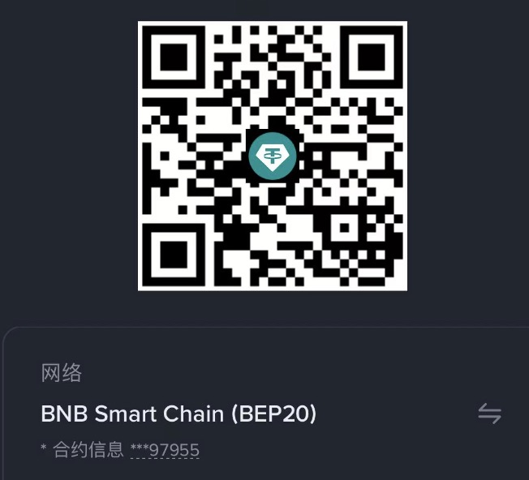
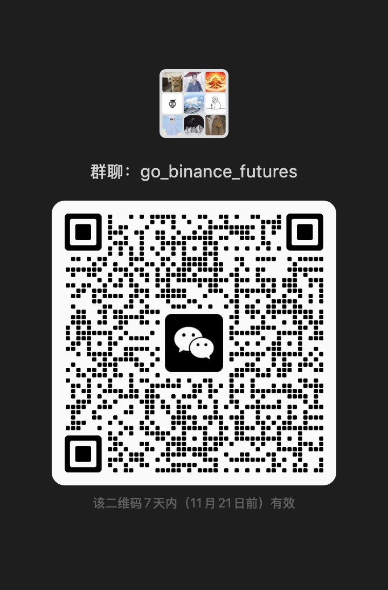

    <a href="./README.md">简体中文</a>
    ·
    <a href="./README.EN.md">English</a>

# Disclaimer

> This project is not investment advice. Users must make their own decisions and bear all investment risks.

# Binance Quantitative Trading

For an introduction, read **[00 · System Overview](doc/readme/en/00-system-overview.md)**. For installation or upgrades, read **[01 · Installation and Initialization](doc/readme/en/01-installation-and-initialization.md)**.

## Documentation

| No. | Module | Description |
| --- | --- | --- |
| 00 | [System Overview](doc/readme/en/00-system-overview.md) | Features, Web UI, operating guidance, and page screenshots |
| 01 | [Installation and Initialization](doc/readme/en/01-installation-and-initialization.md) | Installation, database setup, configuration, and launch |
| 02 | [Futures Trading and Orders](doc/readme/en/02-futures-and-orders.md) | Futures automation, positions, order settings, and execution flow |
| 03 | [Spot Trading](doc/readme/en/03-spot-quant.md) | Automated Spot strategies and trading environment |
| 04 | [Lead Copy Trading](doc/readme/en/04-lead-copy-trading.md) | Lead account management, read-only observer, and deployment restrictions |
| 05 | [Strategies and Backtesting](doc/readme/en/05-strategies-and-backtests.md) | Strategy templates, historical backtests, and paper trading |
| 06 | [Market Monitoring and Alerts](doc/readme/en/06-market-monitoring-and-alerts.md) | Notifications, coin alerts, monitoring, funding rates, and new-coin rush |
| 07 | [AI and Agents](doc/readme/en/07-ai-and-agents.md) | Chat, analysis, Skills, MCP, Memory, tasks, and governance |
| 08 | [System Configuration and Logs](doc/readme/en/08-configuration-and-logs.md) | Diagnostics, log viewing, and log cleanup |
| 09 | [How to Develop](doc/readme/en/09-how-to-develop.md) | Go backend and Vue frontend development, testing, builds, and asset sync |

## Other Technical Documentation

- [Custom Strategy Syntax](STRATEGY.md)
- [Full Order Lifecycle](doc/订单产生与记录完整流程.md)
- [Changelog](CHANGELOG.md)

## Donations

### QR Code

#### BSC–USDT

~~~
0x170197328b6e73597bc29a1b059f29d4e111e1e8
~~~

---

## Community

### WeChat

### Telegram
https://t.me/+neEHA8VSgF1jMTg9
