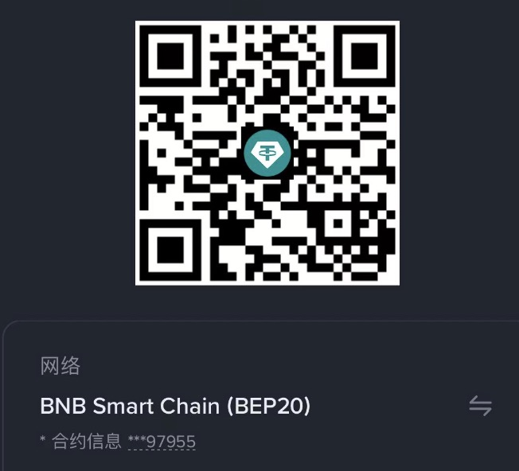

<p align="center">
    <a href="./README.md">简体中文</a>
    ·
    <a href="./README.EN.md">English</a>
</p>

# 免责申明
>！！！本项目不构成任何投资建议，投资者应独立决策并自行承担风险！！！

# 币安量化交易

首次了解系统请阅读 **[00 · 系统概况](doc/readme/zh-CN/00-系统概况.md)**；安装或升级请阅读 **[01 · 安装与初始化](doc/readme/zh-CN/01-安装与初始化.md)**。

## 文档目录

| 顺序 | 模块 | 说明 |
| --- | --- | --- |
| 00 | [系统概况](doc/readme/zh-CN/00-系统概况.md) | 系统功能、Web UI、操作说明与常见问题 |
| 01 | [安装与初始化](doc/readme/zh-CN/01-安装与初始化.md) | 首次安装、数据库初始化、配置、构建、部署与启动 |
| 02 | [合约交易与订单](doc/readme/zh-CN/02-合约交易与订单.md) | 合约自动交易、订单、账户、Ownership 与结算 |
| 03 | [现货交易](doc/readme/zh-CN/03-现货量化交易.md) | 现货自动策略、成交账本和恢复边界 |
| 04 | [合约带单](doc/readme/zh-CN/04-合约带单.md) | 独立 Lead 账户、只读观测与上线限制 |
| 05 | [策略模板与回测](doc/readme/zh-CN/05-策略模板与回测.md) | 自定义策略、历史回测和实时模拟盘 |
| 06 | [行情监控与通知](doc/readme/zh-CN/06-行情监控与通知.md) | 价格提醒、行情监听、资金费率、新币抢购和通知 |
| 07 | [AI 与 Agent 功能](doc/readme/zh-CN/07-AI-Agent.md) | Chat、分析、Skill、MCP、Memory、任务与治理 |
| 08 | [系统配置与日志](doc/readme/zh-CN/08-系统配置与日志.md) | 配置中心、内置日志、诊断与清理 |
| 09 | [如何开发](doc/readme/zh-CN/09-如何开发.md) | Go 后端与 Vue 前端开发、调试、测试、构建与部署 |
| 10 | [币本位合约交易 COIN-M](doc/readme/zh-CN/10-币本位合约交易.md) | 独立 DAPI 交易、合约张数、真实 Fill、反向盈亏、双开关及发布前验收限制 |

## 其他技术文档

- [自定义策略语法](STRATEGY.CN.md)
- [订单产生与记录完整流程](doc/订单产生与记录完整流程.md)
- [版本变更记录](CHANGELOG.md)

## 赞赏

### 二维码


#### bsc-usdt

```
0x170197328b6e73597bc29a1b059f29d4e111e1e8
```

---

## 交流群

### wx


### tg
https://t.me/+neEHA8VSgF1jMTg9
