# System Overview

[中文](../zh-CN/00-系统概况.md) · [Back to English README](../../../README.EN.md)

---

## Features
- Automated futures trading
- Automated spot trading
- Real-time notifications
- Custom trading strategies
- Custom monitoring-event alerts
- Historical futures backtesting
- Futures paper trading
- AI Agents
- New-coin rush trading

---

### Real-time Notifications
> DingTalk, Slack, and in-app WebSocket notifications

- DingTalk
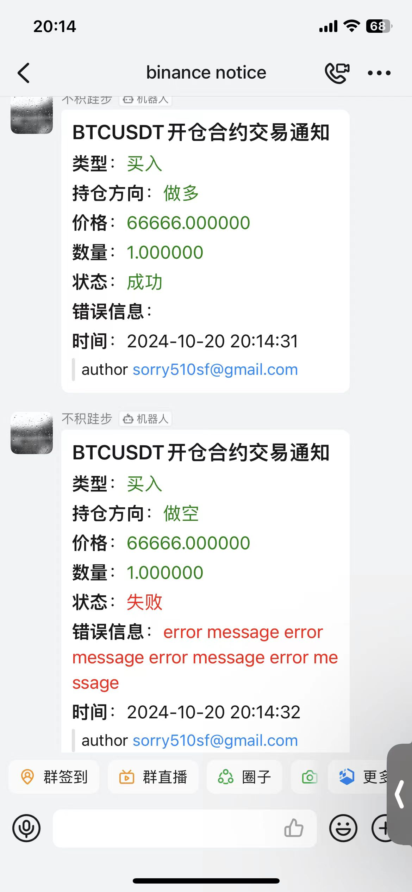
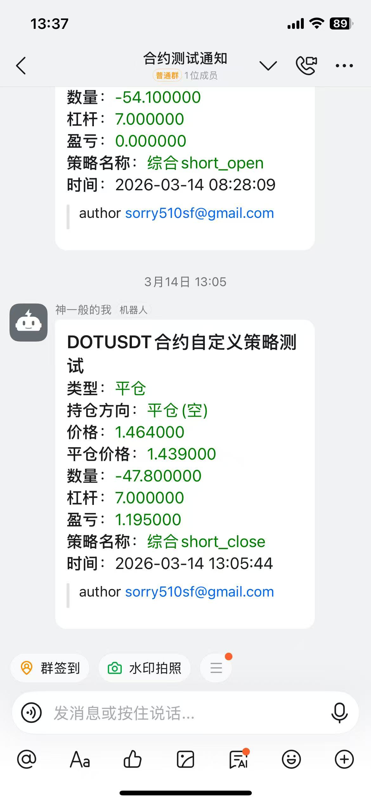
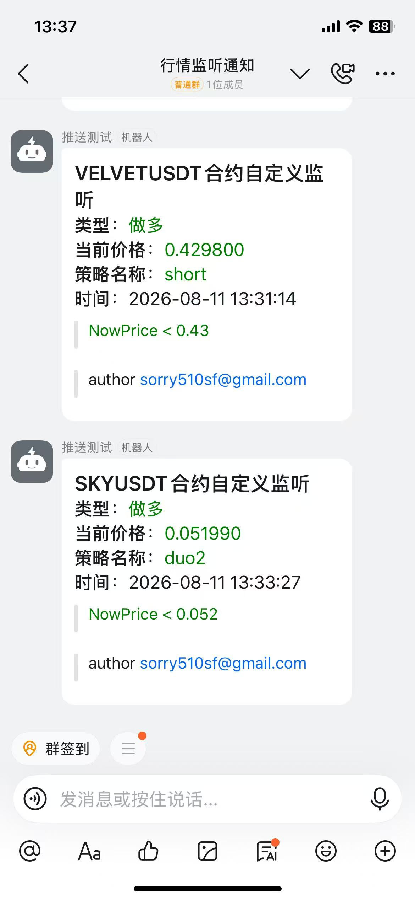

- Slack
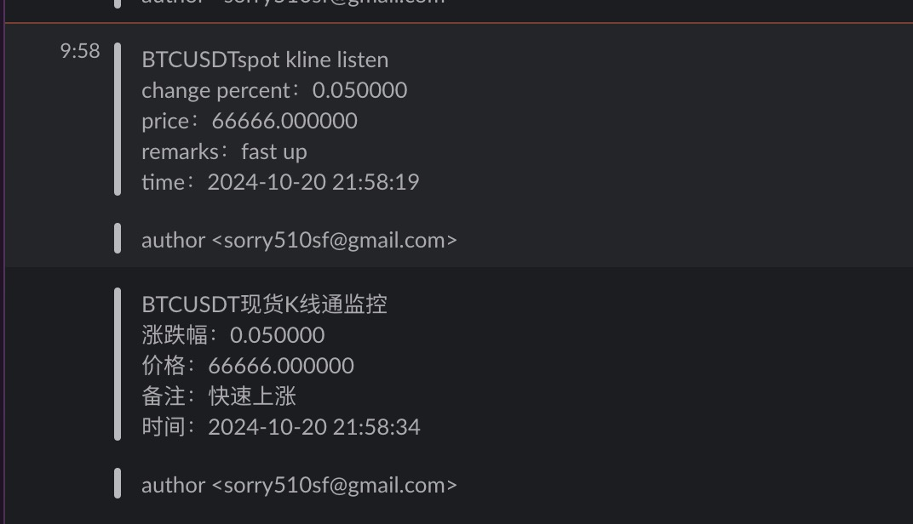

- In-app WebSocket notifications
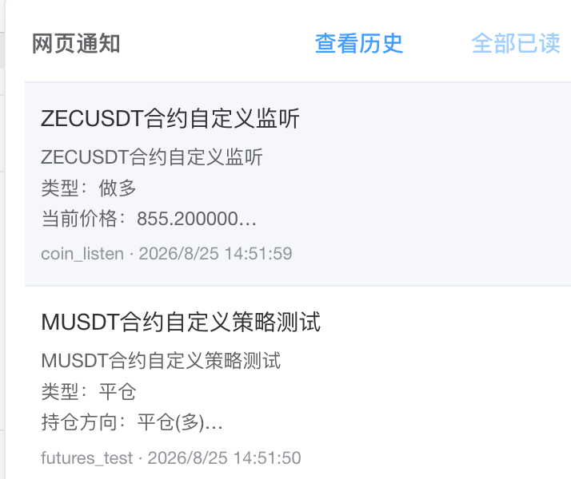

## Web UI

Open `http://<server-ip>:<web.port>/zmkm/index.html` and use the left-hand menu after signing in. The username and password come from `web.username` and `web.password` in `conf/app.conf`.

| Menu | Page and purpose |
| --- | --- |
| System Dashboard | System health indicators and operational statistics |
| Configuration Center | Global trading switches and runtime settings |
| Futures Trading → Futures Trading | Browse, add, search, batch-edit, enable, or disable symbol configurations |
| Futures Trading → Futures Orders | Order history, including bulk hiding/restoring within filters and manual annotations |
| Futures Trading → Futures Positions | Local position ownership, Managed orders, manual claims, reconciliation, and repair history |
| Futures Trading page → Copy Trading button next to Funding Rate | Dedicated Lead account read-only management: credentials and verification, risk controls, pause, managed positions/orders, local audit, and WS/API status. **Live Lead order submission is not authorized.** |
| Futures Trading → Futures Account | Assets, local positions, and local open orders |
| Futures Trading → Strategy Templates | Create and maintain technical-indicator and strategy-method templates |
| Futures Trading → Test Results | Search real-time simulated trades by symbol and date |
| Futures Trading → Historical Backtest | Replay strategies on historical 1m bars, Funding, and MarketCondition; Standard 1m and Adaptive Resolution, trades, equity curves, audit events, and drill-down statistics |
| COIN-M Futures → COIN-M Symbols | USD-inverse perpetual contracts, per-symbol budget/leverage/STOP/TP, LONG/SHORT/CLOSE strategy and entry switches; deploying with both gates enabled can submit live orders |
| COIN-M Futures → Local Account | Read-only Managed cycles, real Fills, asset-separated BTC/ETH PnL and independent read-only COIN-M wallet balances |
| COIN-M Futures → Strategy Templates | Dedicated four-direction COIN-M templates and indicators, separate from USD-M and Spot |
| COIN-M Futures → Positions & Controlled Trading | Local runtime/Managed inventory and unsettled orders, no manual submit/cancel/close endpoints; [documentation](10-coin-m-futures.md) |
| Spot Trading → Spot Trading | Independent Spot symbol configuration, LONG / CLOSE_LONG strategies, indicators, filtering, and enable switches |
| Spot Trading → Local Spot Account | Locally managed positions, orders, actual exchange Fills, and PnL by quote asset; full net PnL is unavailable with stale prices or unvalued fees |
| Spot Trading → Spot Strategy Templates | Spot-specific indicators and strategy templates, separate from Futures |
| Spot Trading → Positions & Controlled Trading | View system-owned inventory and anomalies; manually rebuild local aggregates. Manual selling, cancellation, and exchange reconciliation UI actions are not yet available |
| Coin Alerts → Spot / Futures Alerts | Target-price alerts with optional automatic trading |
| Market Monitoring → Spot / Futures Monitoring | K-line, threshold, indicator, and custom-strategy monitoring |
| AI → Chat | Multi-turn Agent conversations, symbol selection, model switching, and mounting multiple Skills |
| AI → Market Analysis | **Symbol Analysis / Opportunities** tabs: structured TradingPlans, historical analysis, opportunity review, and controlled-trade proposals |
| AI → Business Workflows | Five manually executable workflows. Strategy Draft Validation compiles expressions and tests synthetic scenarios only; **it is not a historical backtest**. Qualified market-scan candidates are sent to opportunity analysis asynchronously |
| AI → Task Center | **Tasks / Scheduler & Governance / Alert Pipeline** tabs: execution details, scheduling status, metrics, and alert history |
| AI → AI Settings | **AI Configuration / Models / Skills / MCP / Memory** tabs, opening on AI Configuration to manage opportunity monitoring, alerts, scheduling, trade risk, and AI runtime settings |
| Notifications | Review notification history and configure delivery |
| New-Coin Rush | Configure launch-time Spot, mining-token, and Futures trades |
| System Configuration | Edit the configuration file with Save and Restart to apply |
| Logs | View application logs |

---

## UI Screenshots

#### System Dashboard
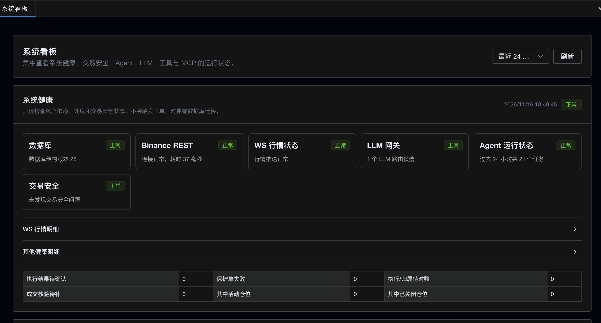
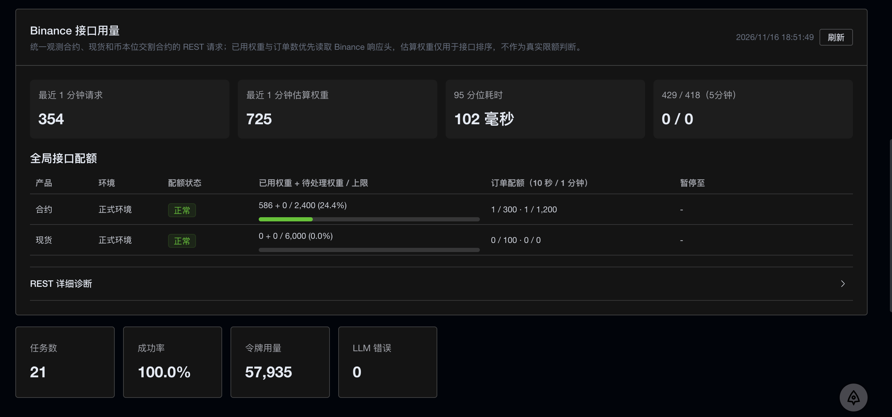

#### Configuration Center
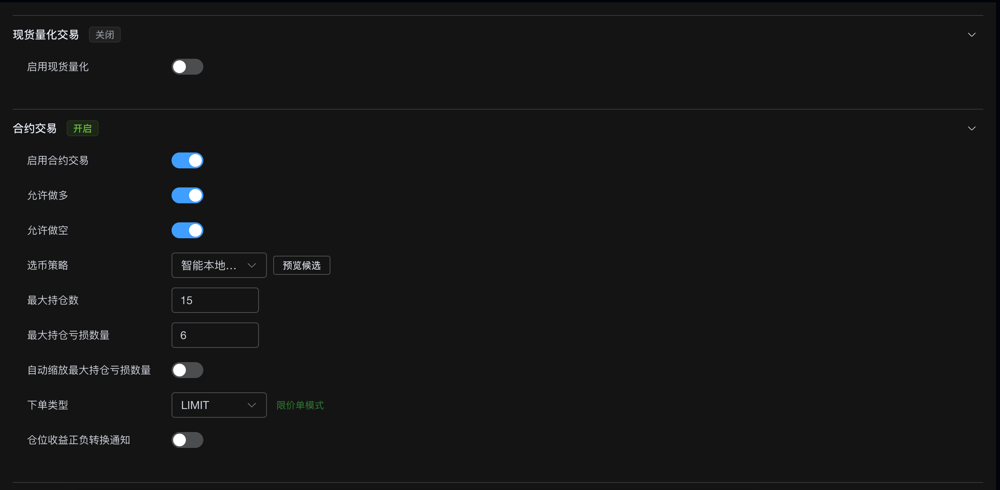
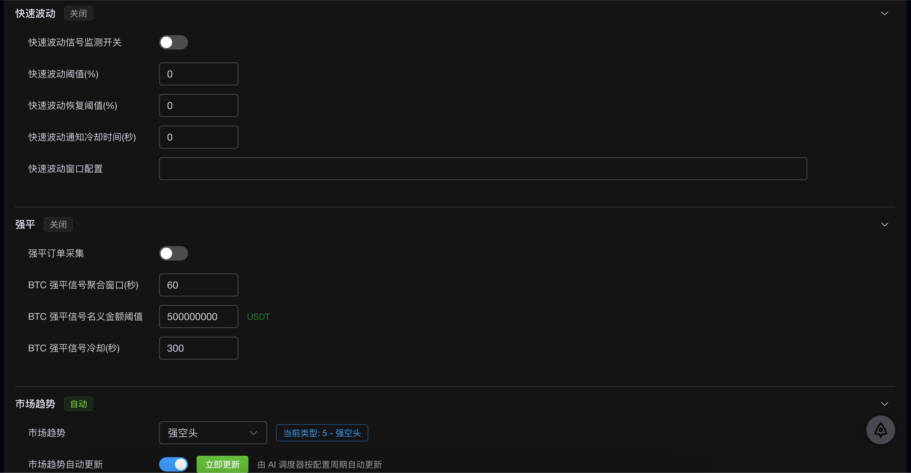
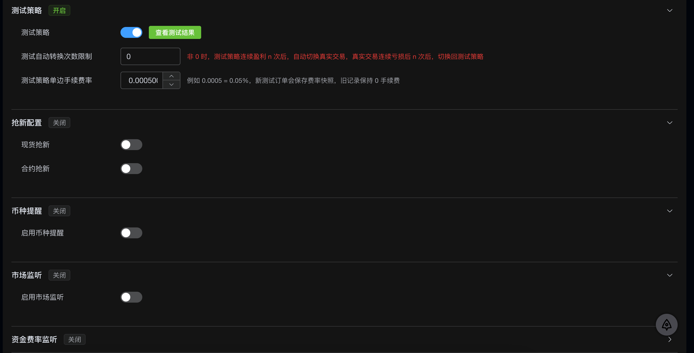

#### Futures Trading
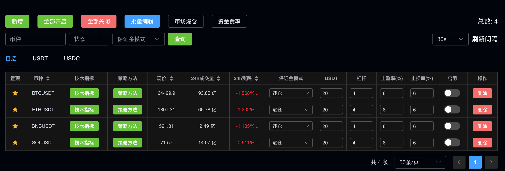

#### Futures Orders
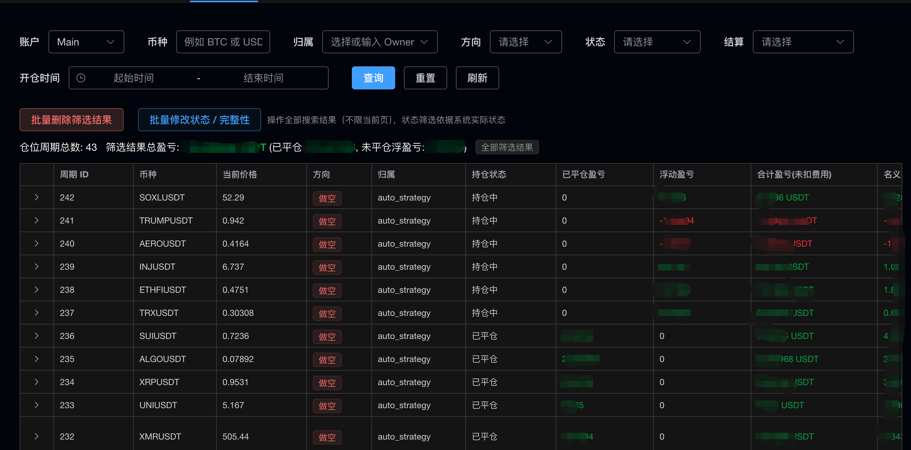

#### Futures Positions
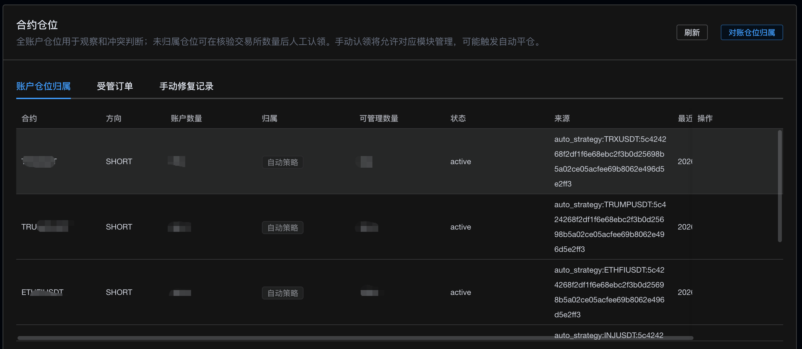

#### Lead Copy Trading

#### Futures Account
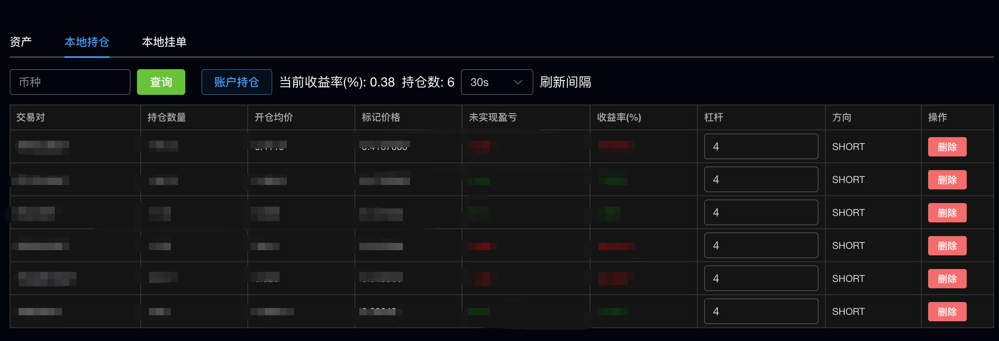

#### Strategy Templates
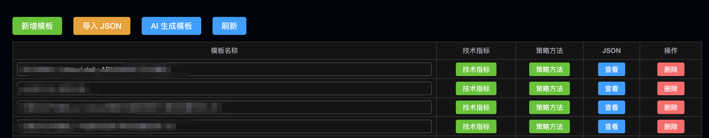

#### Test Results
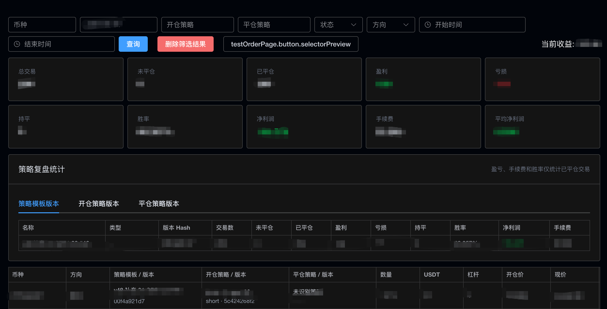

#### Historical Backtest
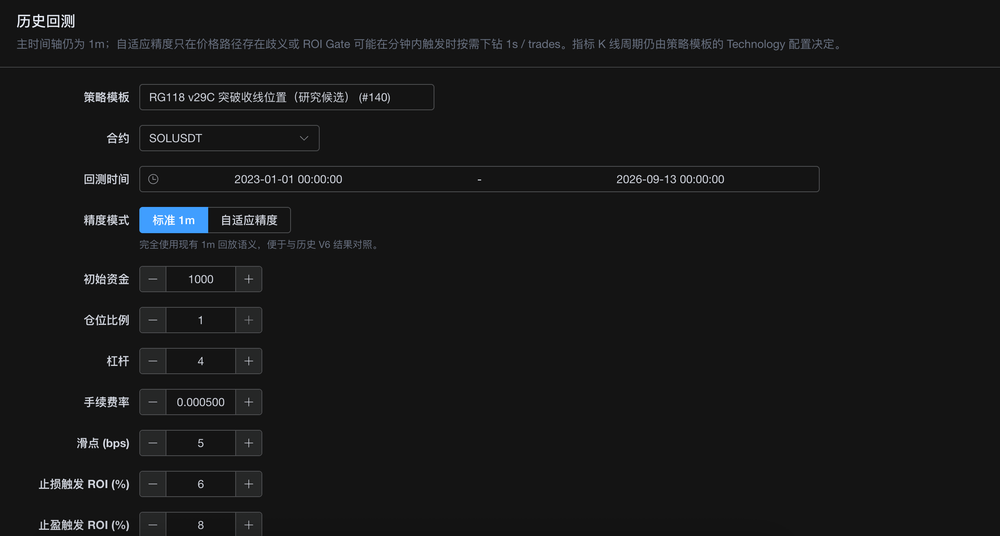
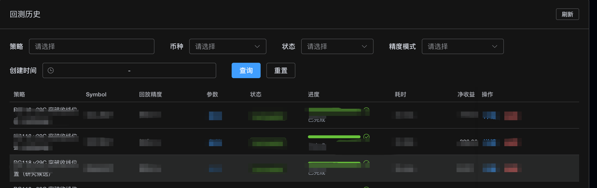

#### Spot Alerts
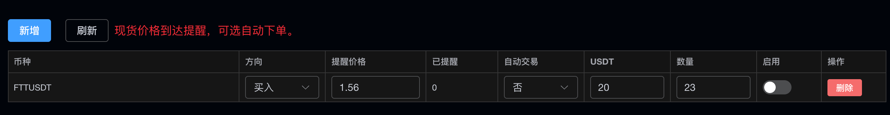

#### Futures Alerts
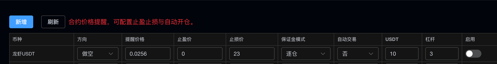

#### Spot Monitoring
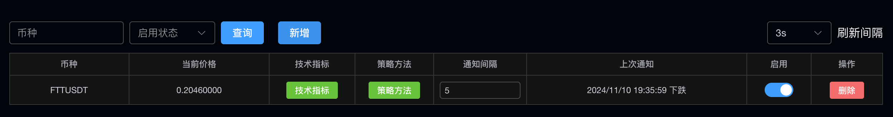

#### Futures Monitoring
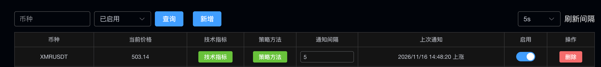

#### AI – Chat
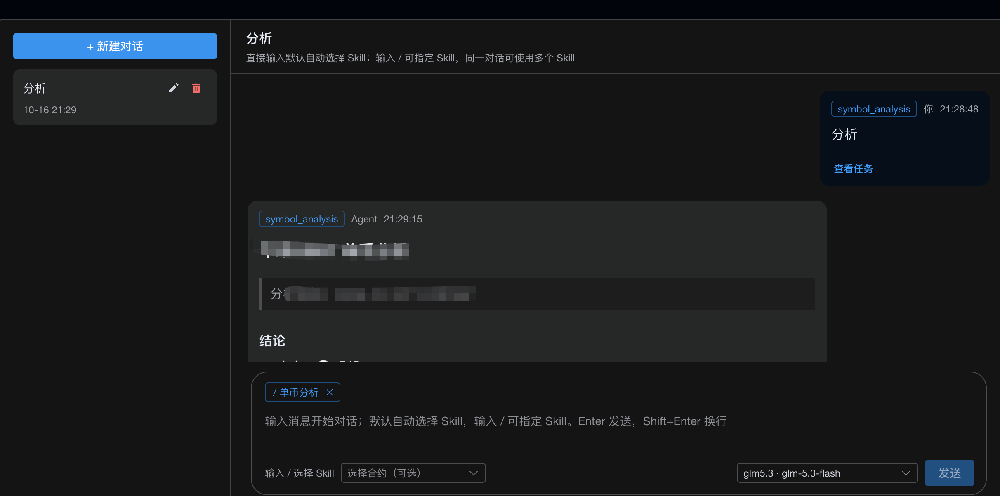

#### AI – Market Analysis
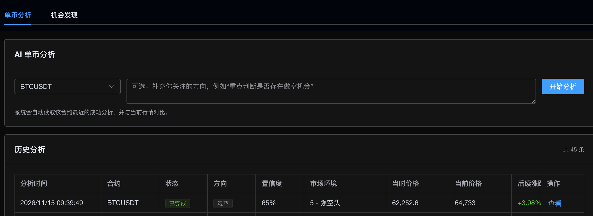

#### AI – Settings
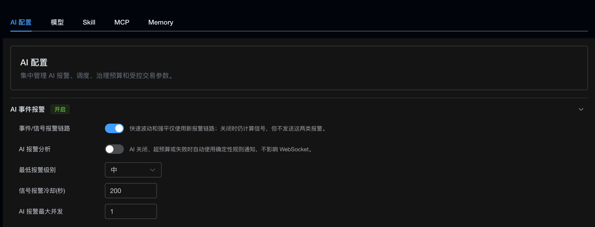

#### Notification Configuration
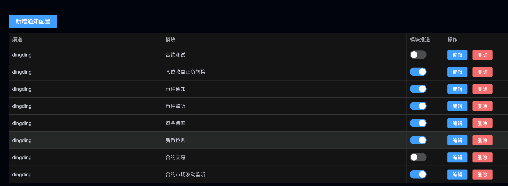

#### Notification History
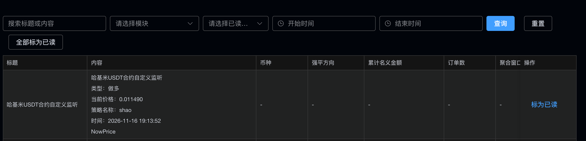

#### New-Coin Rush
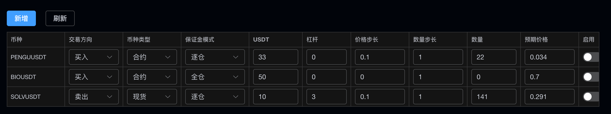

#### System Configuration
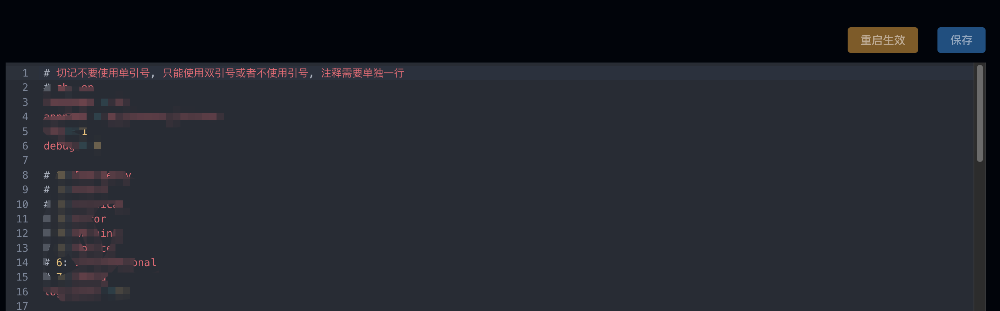

#### Logs
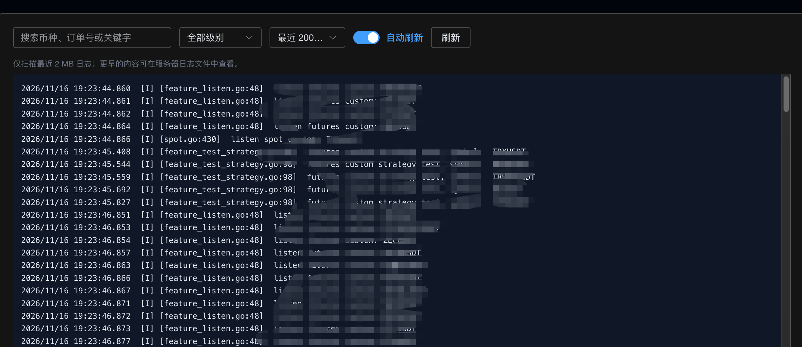
