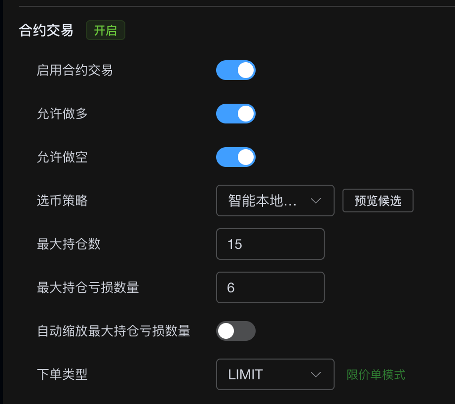
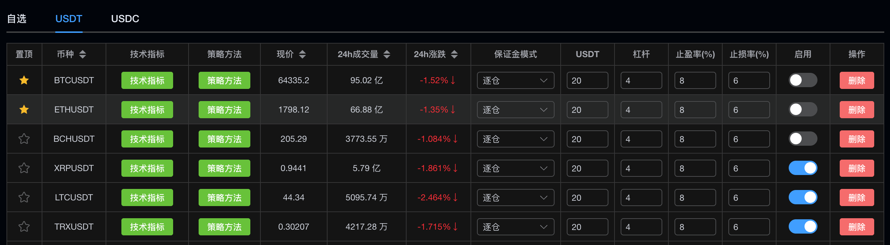

# Futures Trading and Orders

[中文](../zh-CN/02-合约交易与订单.md) · [Back to English README](../../../README.EN.md)

## Futures Trading

The **Futures Trading → Futures Trading** page allows per-symbol configurations for technical indicators, strategy methods and templates, margin mode, USDT collateral, leverage, take-profit and stop-loss percentages, and enabled status. Every Futures symbol uses its own custom strategy; there is no strategy-type selector.

### Enabling Futures Trading

1. In the **Configuration Center → Futures Trading** Card, turn on **Enable Futures Trading**.
2. Enable **Allow Long** and/or **Allow Short** as needed; configure the symbol-selection strategy, position limits, and order type.

3. Under **Futures Trading → Futures Trading**, verify the target symbol's custom strategy, trade parameters, and **Enabled** status.

#### Important Notes

1. A symbol's close strategy is evaluated only after the configured **Take Profit (%)** or **Stop Loss (%)** threshold has been exceeded.
2. Each Futures symbol uses its own custom strategy configuration.
3. The symbol's USDT amount represents the Futures margin.

### Configuration Options

#### Fast Price Movement (Optional)

**Configuration Center → Fast Price Movement** controls whether fast-move monitoring is enabled, its threshold, recovery threshold, cooldown, and monitoring windows.

#### Liquidations (Optional)

**Configuration Center → Liquidations** controls liquidation-order collection, BTC liquidation signal aggregation windows, notional threshold, and cooldown.

#### Position PnL Sign-Change Notifications (Optional)

This switch is below **Order Type** in **Configuration Center → Futures Trading**. It sends a notification when a position's PnL changes from positive to negative or vice versa. Large numbers of positions or enabled symbols may increase API requests, so enable it with care.

#### Allow Long and Allow Short (At Least One Required for Trading)

These are direction-wide switches. When a direction is disabled, a matching strategy signal cannot automatically open a position in that direction.

#### Symbol-Selection Strategy (Required)

Determines the pool of candidates for automatic trading. It does not alter the custom trading strategy executed by an individual symbol.

#### Maximum Positions (Required)

When the limit is reached, no further positions are opened automatically even if a strategy signal is valid.

#### Maximum Losing Positions (Required)

No new automatic position is opened after this limit is reached. **Automatically Scale Maximum Losing Positions** can adjust the limit based on consecutive wins/losses.

#### Market Condition (Optional)

**Configuration Center → Market Condition** allows manual market-condition selection or automatic updates. The Card title shows an **Auto / Manual** status tag, and the Card displays progress and recent AI analysis.

#### Automatic Order Type

`LIMIT` creates limit orders; `MARKET` creates market orders. The UI displays the applicable options according to the selected type.

### Quantitative Trading Flow

1. When Futures trading is enabled, the system continuously evaluates each symbol's custom strategy to decide whether to open or close a position.
2. With `LIMIT` entry orders, a pending order is placed. It may not fill, and the system cancels it after the configured timeout.
3. After an entry fills successfully, its records are available under **Futures Orders** and **Futures Positions**.
