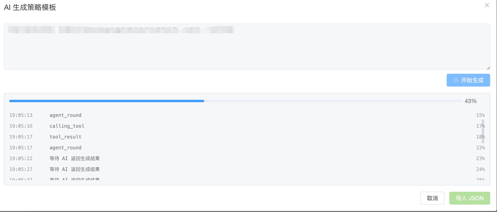

# Strategies and Backtesting

[中文](../zh-CN/05-策略模板与回测.md) · [Back to English README](../../../README.EN.md)

## custom strategy

### ai strategy create

### desc

In the UI, maintain technical indicators and strategy methods under **Futures Trading → Strategy Templates**, then apply templates or edit strategy configurations for symbols under **Futures Trading → Futures Trading**.

<a href="../../../STRATEGY.md">custom strategy details</a>

---

## Historical Backtest

**Futures Trade → Historical Backtest** replays a strategy on historical market data. It is separate from the real-time `Test Strategy` paper-trading feature. A backtest never submits a real Binance order and is intended for comparing strategy versions, cost/leverage parameters, and execution-resolution models.

### Replay modes

- **Standard 1m:** uses 1-minute bars as the execution timeline together with historical K-lines, Funding, MarketCondition, and the selected strategy template. It is the fastest mode and is the recommended baseline.
- **Adaptive Resolution:** keeps 1m as the primary timeline. Only minutes whose intraminute order cannot be determined from the 1m bar, or whose ROI Gate may become valid intraminute, are drilled down to `1s`; if a second is still ambiguous, the engine replays individual `trades`. The system does not convert the entire historical range into second-level or tick-level data.
- A 1m `High/Low` is only a candidate detector. It does not mean a take-profit/stop-loss was automatically filled. The close rule is re-evaluated at 1s/trade time, so Adaptive and Standard runs can legitimately produce different exit times, trade counts, and PnL.

### Historical data and high-resolution cache

Base replay data comes from locally stored historical K-lines, required indicator intervals, Funding, and MarketCondition. The **Fetch Historical Data** action prepares only this base dataset. High-resolution data remains lazy and is fetched only when an Adaptive run actually needs it.

High-resolution requests first use the sparse database cache:

- `market_klines_1s` stores only 1s bars for minutes that were actually drilled down.
- `market_trades` stores only the trade ranges that were actually required.
- When a Binance USD-M Futures 1s archive is unavailable for a date, the provider falls back to Binance Public Data daily trades ZIPs and aggregates the verified trades into 1s bars for the requested minute.
- Sparse data is reusable across runs. A first Adaptive run may need to download and parse large daily trades ZIPs; later runs over the same ranges are usually much faster once the database cache is populated.
- Every ZIP is checked against Binance's SHA256 `.CHECKSUM`. Trades are ordered by `trade_time + trade_id` to make same-millisecond replay deterministic.

### Results, auditability, and reproducibility

Each run stores the strategy version, time range, initial equity, position size, leverage, fee rate, slippage, take-profit/stop-loss parameters, and exposes metrics such as net PnL, return, maximum drawdown, win rate, Profit Factor, Sharpe, Sortino, fees, Funding, trade count, holding time, and side-level breakdowns.

Adaptive runs additionally record:

- 1s drill-down minutes and trade drill-down seconds.
- 1s/trade cache hits, archive cache hits, ZIP download count, and download bytes.
- Per-trade `entry_resolution` / `exit_resolution` such as `1m`, `1s`, or `trades`.
- Intrabar Resolution audit events and the high-resolution evidence actually consumed by the run.
- A `DataHash` extended with the consumed high-resolution evidence, plus the Engine/Resolution Model version used for the run.

The UI shows live stages for dataset building, normal replay, high-resolution cache access, ZIP download, ZIP parsing, and result persistence, together with elapsed run time. Trades and Audit Events are paginated so long backtests do not load every detail into the browser at once.

### Recommended workflow

1. Open **Futures Trade → Historical Backtest**, select the strategy template, Symbol, time range, and replay mode, then configure equity, position size, leverage, fees, slippage, take profit, and stop loss as needed.
2. For a long first run, use **Fetch Historical Data** first. If historical MarketCondition data is missing, use the backfill action on the same page.
3. When comparing Standard and Adaptive, keep `start_time`, `end_time`, strategy version, and all run parameters identical; otherwise a different time window can be mistaken for a resolution difference.
4. The first Adaptive run can be dominated by Binance Public Data ZIP downloads. On a repeated run, `second_cache_hits` / `trade_cache_hits` close to their drill-down counts with `archive_downloads=0` indicates that the database high-resolution cache is working.

> A backtest is a historical simulation, not a full exchange matching-engine replica. Order-book queue position, maker queueing, and full partial-fill depth are not modeled, and historical results do not guarantee future performance.

---

## real-time custom-strategy paper trading (separate from historical backtesting)

Enable paper trading in the standalone **Configuration Center → Test Strategy** Card. Core WebSocket streams start automatically. Simulation uses the same per-symbol custom strategies and trading limits as real automatic trading but does not operate the real futures account. Open results from the Card's `View Test Results` button or **Futures Trade → Test Results**.

When the `Test Auto-Conversion Count Limit` is non-zero, consecutive simulated wins can switch to real trading; consecutive real-trading losses can switch back to test mode.

---

## strategy-templates

Create and maintain templates under **Futures Trade → Strategy Templates**. A template contains indicators and strategy methods and can be reused by futures symbols and monitoring rules. See [Custom Strategy Details](../../../STRATEGY.md) for syntax.

---

## Custom Trading Strategy
> Futures symbols always use the custom-strategy engine; there is no global trading strategy or strategy-type selector. See `feature/strategy/line/line_custom.go` and [Custom Strategy Details](../../../STRATEGY.md).
