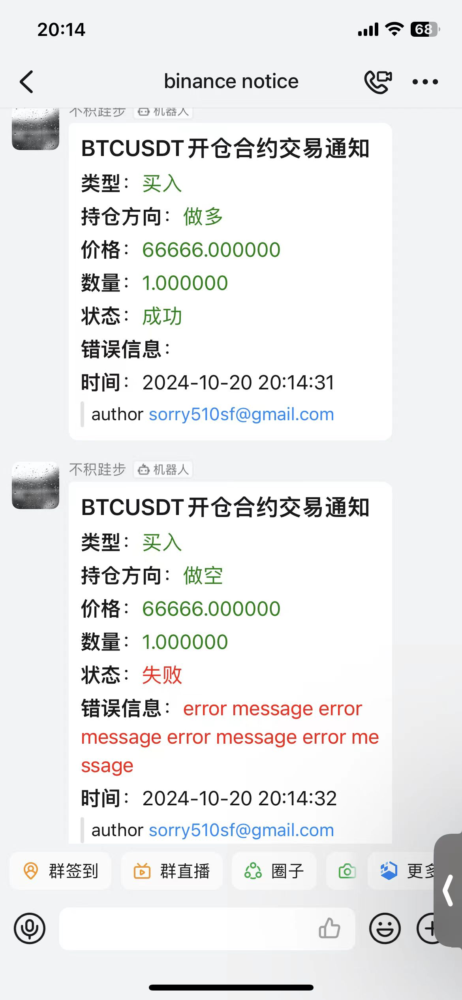
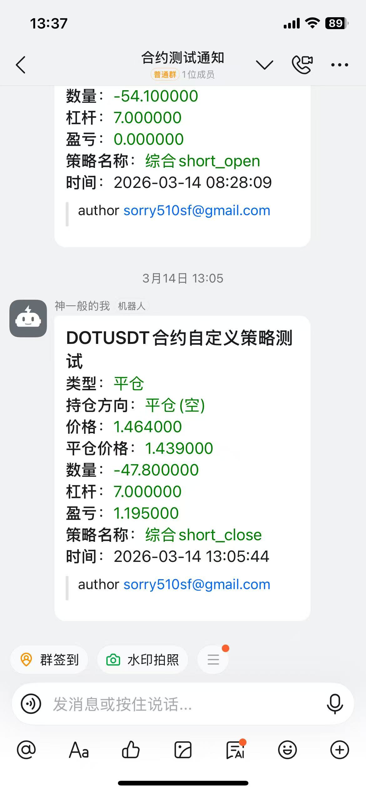
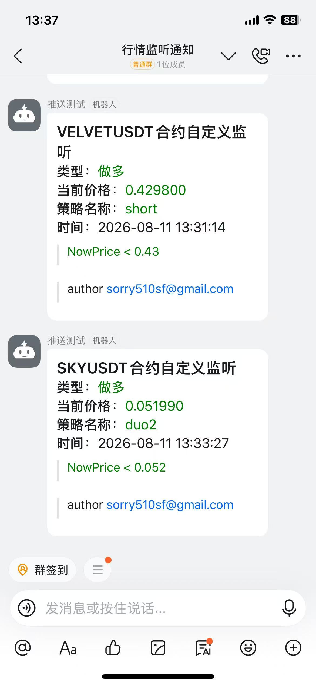
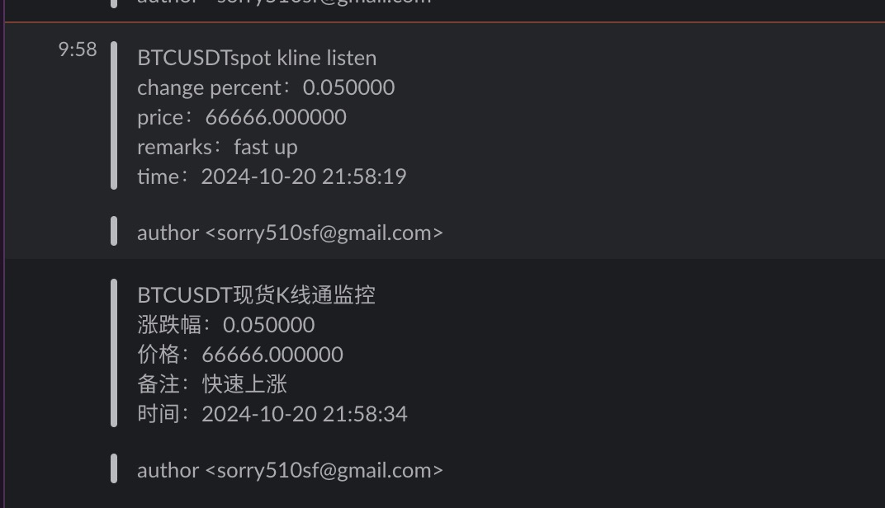
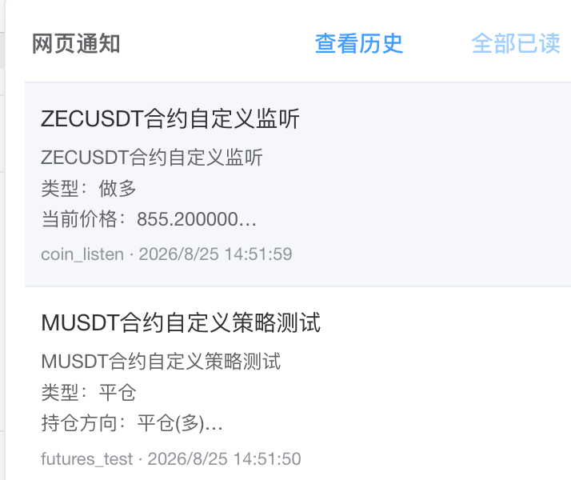

# Market Monitoring and Alerts

[中文](../zh-CN/06-行情监控与通知.md) · [Back to English README](../../../README.EN.md)

## Real-time Notifications
> DingTalk, Slack, and in-app WebSocket notifications

- DingTalk

- Slack

- In-app WebSocket notifications

---

## New-Coin Rush

- spot rush buy
- mining rush sell
- futures rush long
- futures rush short

First enable the corresponding switch under **Configuration Center → New-Coin Rush**, then add the symbol rule on the **New-Coin Rush** page.

---

## Coin Alerts

### spot-notice

- alarm notification for reaching the preset price
- automatic buying or selling

### futures-notice

- alarm notification for reaching the preset price
- optional automatic trading with margin mode, USDT, leverage, take-profit price, and stop-loss price

Enable the master switch under **Configuration Center → Coin Alerts**, then maintain rules under **Coin Alerts → Spot Alerts** or **Futures Alerts**.

---

## Market Monitoring

### spot-listen

- K-line change monitoring
- configurable threshold, notification interval, and enabled status

### futures-listen

- K-line and indicator monitoring
- custom strategy

Enable the master switch under **Configuration Center → Market Monitoring**, then add rules under **Spot Monitoring** or **Futures Monitoring**.

---

## Funding Rates

- funding rate search and history (database pagination for the main list, 50 rows per page by default; 50 rows per page in the history dialog)
- funding rate change listen

Enable the master switch under **Configuration Center → Funding Rate Monitoring**, then use **Futures Trade → Futures Trade → Funding Rate** (after Batch Edit) to open the original page. The adjacent **Market Liquidations** button opens the former liquidation-orders page; neither has a standalone sidebar entry.

---

## New-Coin Rush Configuration Examples

#### spot rush buy

| coin  |  trade_type | coin_type  | usdt  | step_size  | enable  |
| ------------ | ------------ | ------------ | ------------ | ------------ | ------------ |
| ABCUSDT  | buy  | spot  | 10  |0.1(if you don't know, please fill in 0)   | open   |

#### spot mining rush sell
> Note: A transaction cannot be placed when the mined tokens are worth less than 5 USDT.

| coin  |  trade_type | coin_type  | step_size  | amount  | enable  |
| ------------ | ------------ | ------------ | ------------ | ------------ | ------------ |
| ABCUSDT  | sell  | spot  | 0.1(if you don't know, please fill in 0)   | 80(Quantity of mining income) | open  |

#### futures rush buy long

| coin  |  trade_type | coin_type  | margin_type | usdt|  leverage | step_size  |  enable  |
| ------------ | ------------ | ------------ | ------------ | ------------ | ------------ |------------ | ------------ |
| ABCUSDT  | buy_long  | futures  | ISOLATED or CROSSED| 10|3 | 0.1(if you don't know, please fill in 0)  | open   |

#### futures rush buy short
| coin  |  trade_type | coin_type  |margin_type| usdt|  leverage | step_size  |  enable  |
| ------------ | ------------ | ------------ | ------------ | ------------ | ------------ |------------ | ------------ |
| ABCUSDT   | buy_short  | futures  | ISOLATED or CROSSED | 10|3 | 0.1(if you don't know, please fill in 0)   | open   |
