# 系统概况

[返回中文 README](../../../README.md) · [English](../../../README.EN.md)

---

## 功能
- 合约量化交易
- 现货量化交易
- 实时消息推送
- 自定义策略
- 自定义监听事件报警
- 合约历史回测
- 合约测试交易
- AI agent
- 抢新交易

---

### 实时推送
> dingding, slack, 网页 websocket 通知

- 钉钉
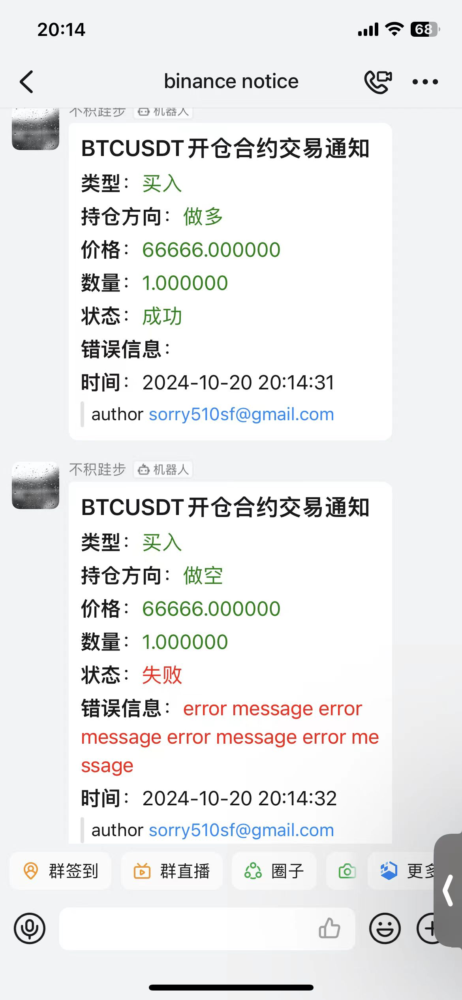
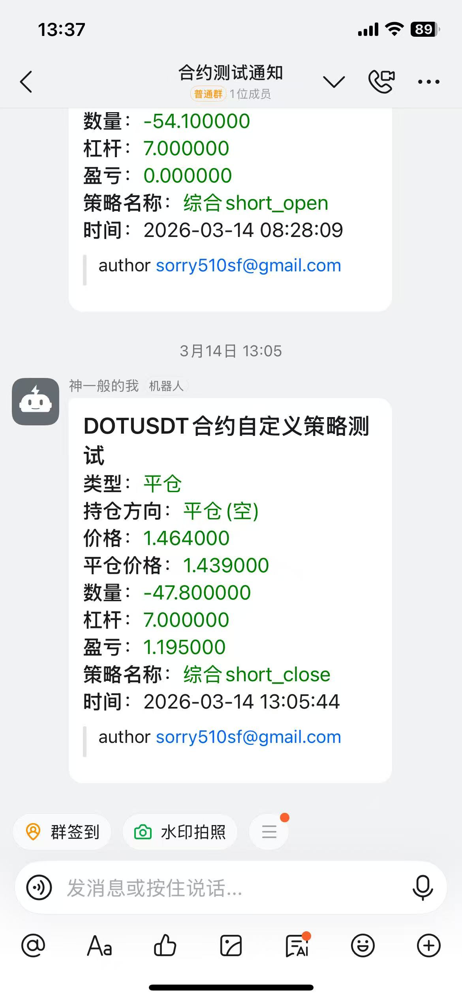
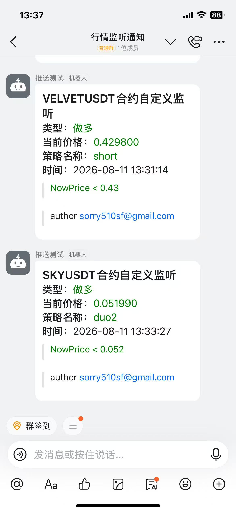

- slack
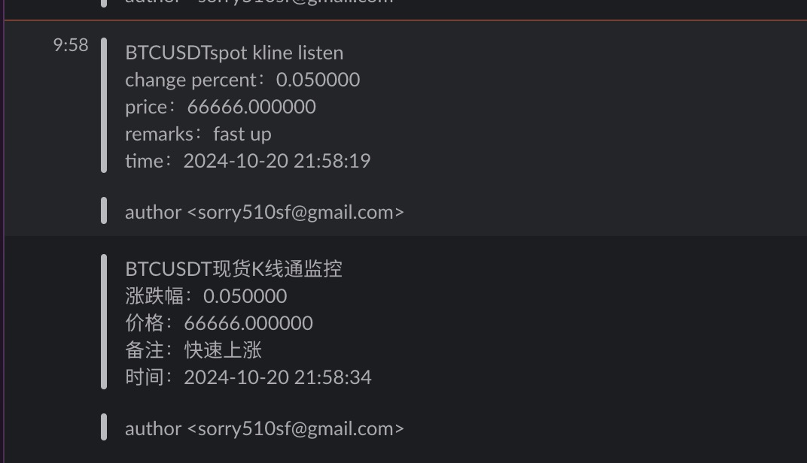

- 网页 websocket 通知
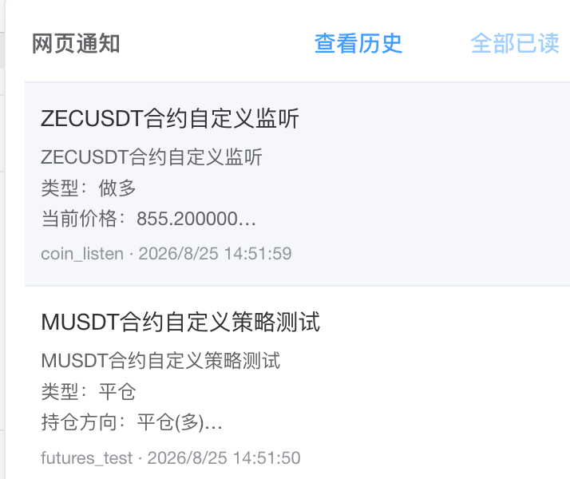

## Web UI

访问 `http://<服务器 IP>:<web.port>/zmkm/index.html`，登录后通过左侧菜单进入各功能页。登录账号和密码来自 `conf/app.conf` 的 `web.username`、`web.password`。

| 菜单 | 页面与用途 |
| --- | --- |
| 系统看板 | 系统指标监控+各项数据统计 |
| 配置中心 | 各种交易的开关和数据配置 |
| 合约交易 → 合约交易 | 查看币种；新增、查询、批量编辑、全部开启或全部关闭币种配置 |
| 合约交易 → 合约订单 | 订单历史（现已支持筛选范围批量隐藏/恢复和人工标注 |
| 合约交易 → 合约仓位 | 本地仓位归属、Managed 订单、手动认领、归属对账和修复历史 |
| 合约交易 → 合约带单 | 独立 Lead 账户的只读管理界面：凭证与只读验证、账户风控、暂停、受控持仓/订单、本地审计和 WS/API 状态；**当前不允许真实带单下单** |
| 合约交易 → 合约账户 | 显示（资产、本地持仓、本地挂单） |
| 合约交易 → 策略模板 | 新增和维护技术指标、策略方法模板 |
| 合约交易 → 测试结果 | 查询实时模拟交易结果，可按币种和时间筛选 |
| 合约交易 → 历史回测 | 使用历史 1m 行情、Funding 与 MarketCondition 回放策略；支持标准 1m 与自适应精度模式，并查看交易、权益曲线、审计事件和高精度下钻统计 |
| 现货量化交易 → 现货量化交易 | 独立现货币种配置与 LONG / CLOSE_LONG 自定义策略，支持币种筛选、技术指标和启停 |
| 现货量化交易 → 本地现货账户 | 独立的本地策略仓位、订单、真实逐笔成交 Fill 与分报价币盈亏；过期行情或未折价手续费不显示完整净收益 |
| 现货量化交易 → 现货策略模板 | 现货专用策略/技术指标模板管理，与合约模板分离 |
| 现货量化交易 → 仓位与受控交易 | 查看本系统持仓及异常、手动重算本地汇总；页面手动卖出、撤单与交易所对账暂不开放 |
| 币种提醒 → 现货提醒 / 合约提醒 | 配置到价提醒和可选的自动交易 |
| 市场监听 → 现货监听 / 合约监听 | 配置 K 线、阈值、技术指标和自定义策略监听 |
| AI → 对话 | 统一 Agent 多轮对话、Symbol 选择、模型切换和多 Skill 挂载入口 |
| AI → 市场分析 | **单币分析 / 机会发现** 两个标签；结构化 TradingPlan、历史分析和机会审核、受控交易提议 |
| AI → 业务 Workflow | 五种业务流程手动执行；其中「策略草案验证」只做表达式编译及模拟场景验证，**不等于历史回测**；手动市场扫描的合格候选异步衔接机会分析 |
| AI → 任务中心 | **执行任务 / 定时任务与治理 / 报警链路** 三个标签；统一查看执行审计、Scheduler 状态、运行指标及报警历史 |
| AI → AI 设置 | **AI 配置 / 模型 / Skill / MCP / Memory** 五个标签；默认显示第一个「AI 配置」，集中管理机会监控、报警、调度、交易风控和 AI 运行配置 |
| 通知 |查看通知历史和配置通知 |
| 抢新配置 | 配置现货、挖矿币和合约的新币抢购 |
| 系统配置 | 在线编辑配置文件，提供「保存」与「重启生效」 |
| 日志 | 查看系统应用日志 |

---

## UI 页面截图

#### 系统看板
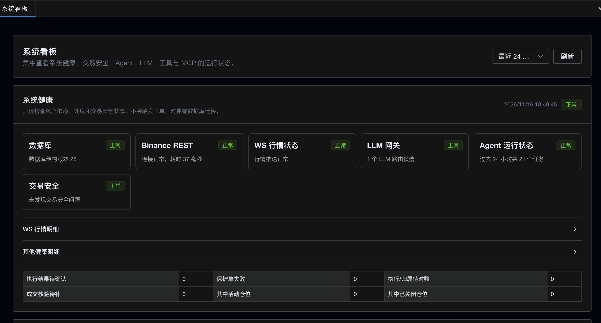
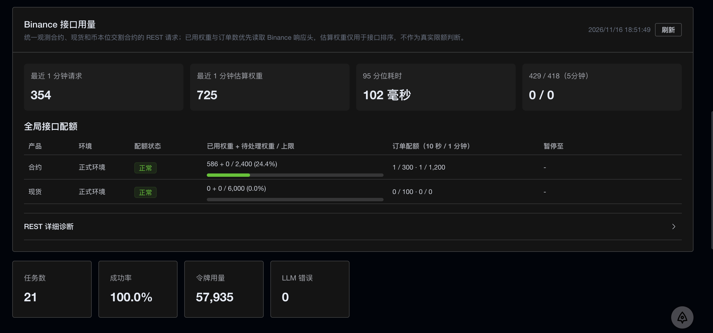

#### 配置中心
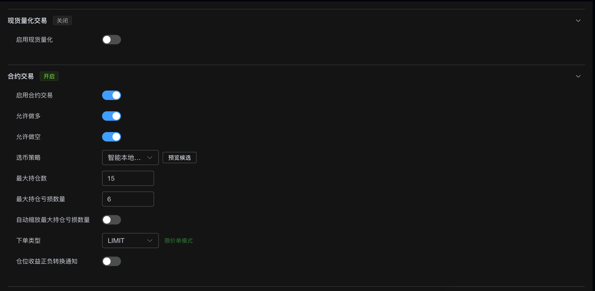
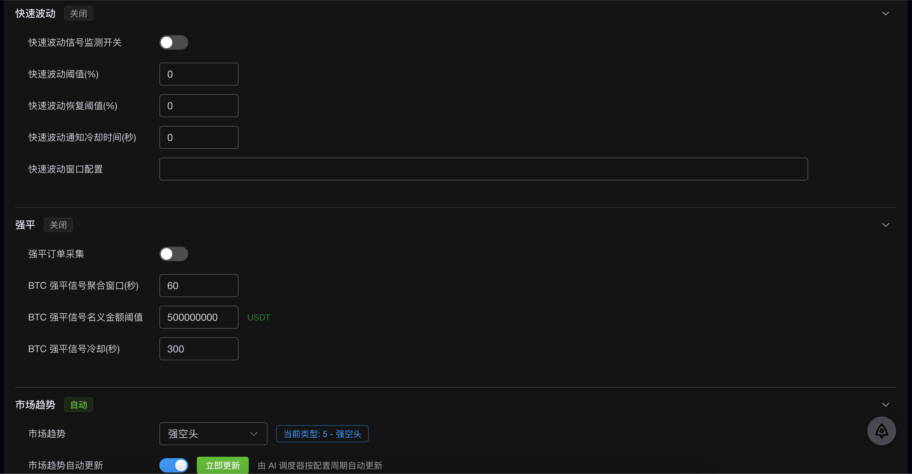
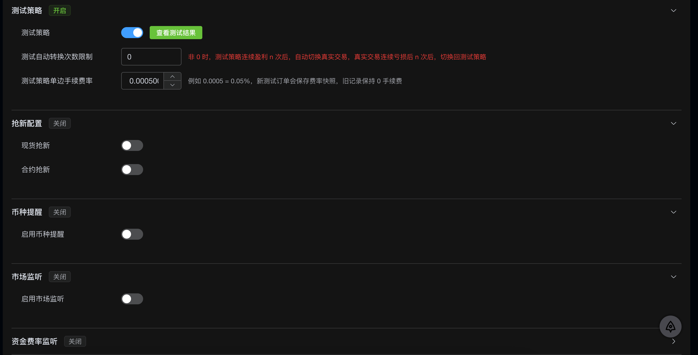

#### 合约交易
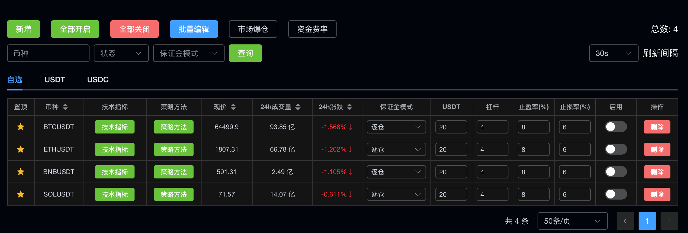

#### 合约订单
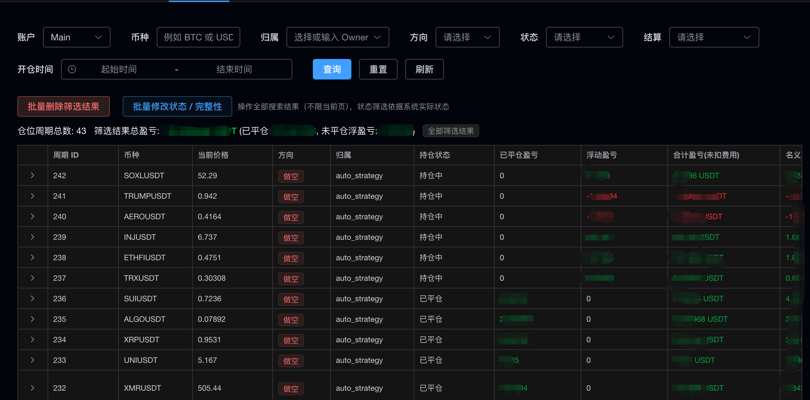

#### 合约仓位
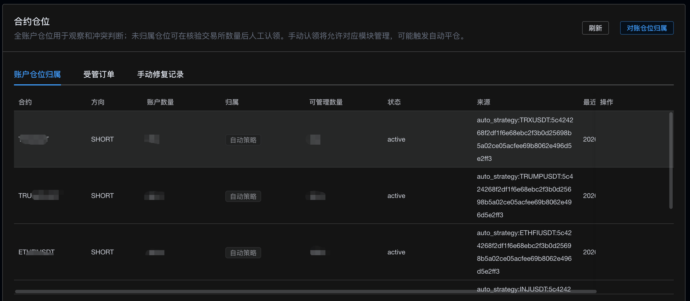

#### 合约带单

#### 合约账户
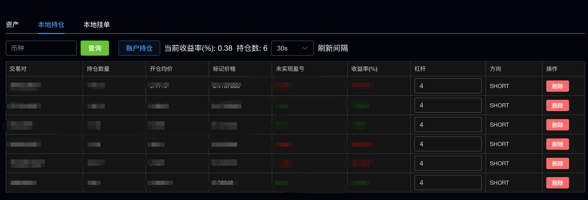

#### 策略模板
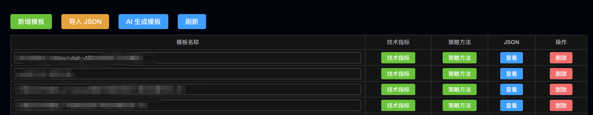

#### 测试结果
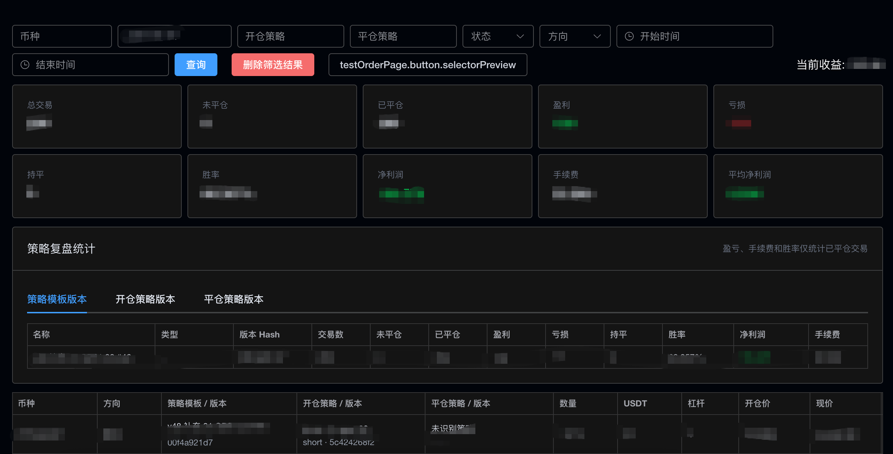

#### 历史回测
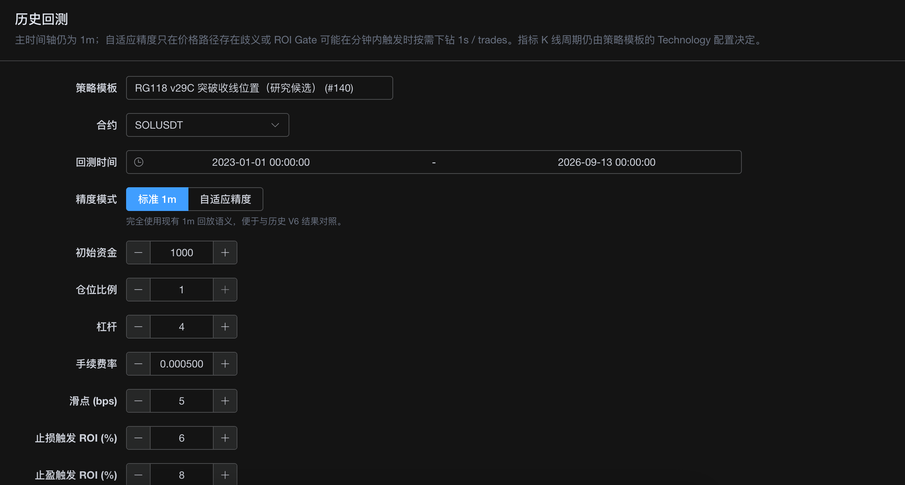
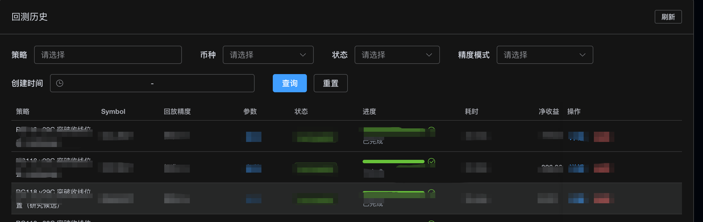

#### 现货提醒
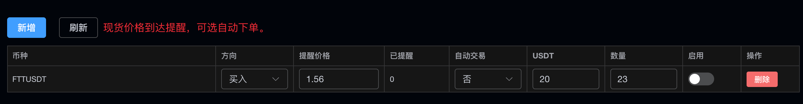

#### 合约提醒
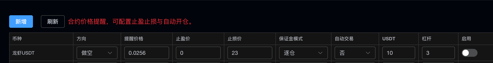

#### 现货监听
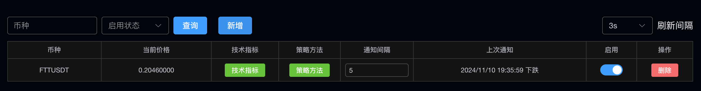

#### 合约监听
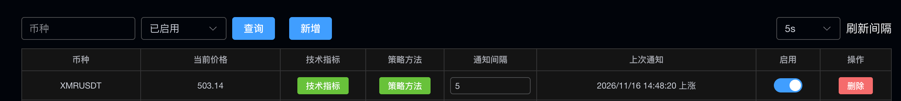

#### AI - 对话
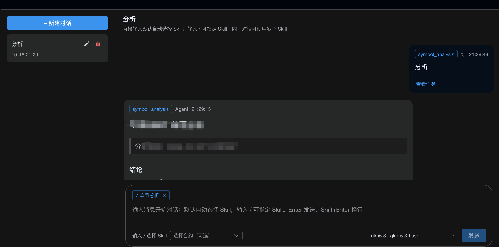

#### AI - 市场分析
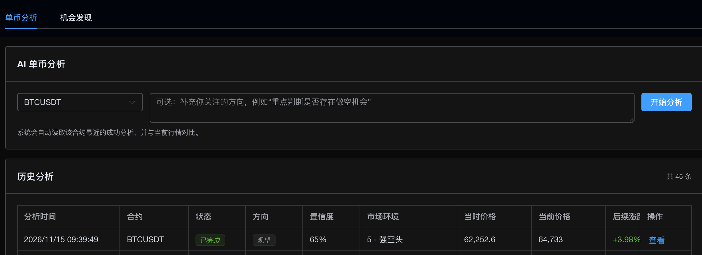

#### AI - 设置
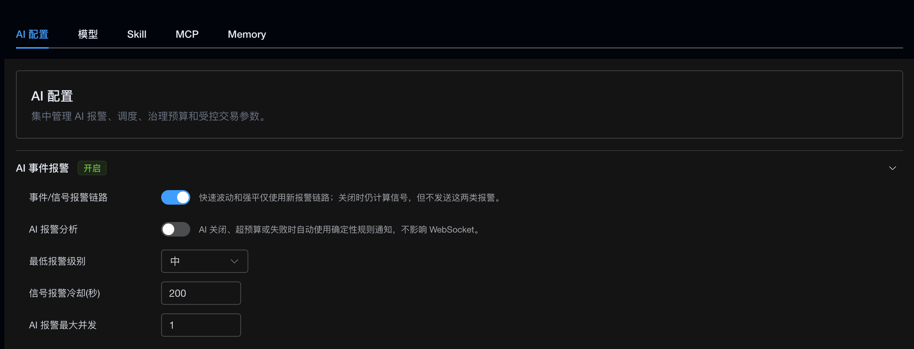

#### 通知配置
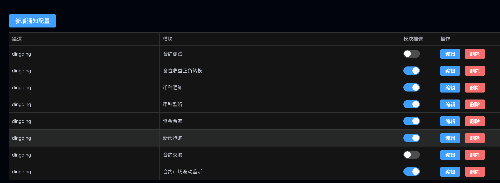

#### 历史通知
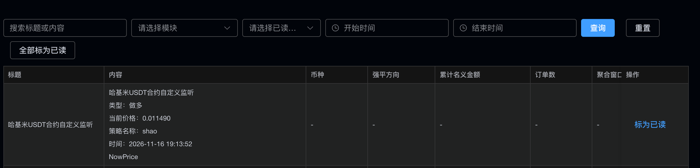

#### 抢新配置
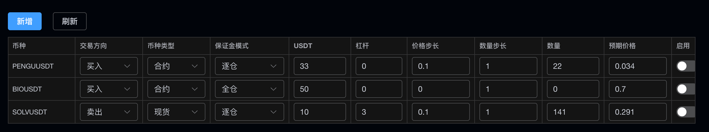

#### 系统配置
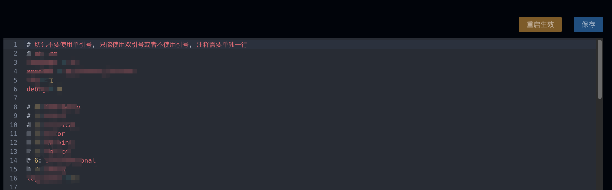

#### 日志
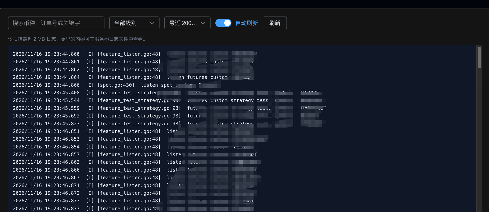

