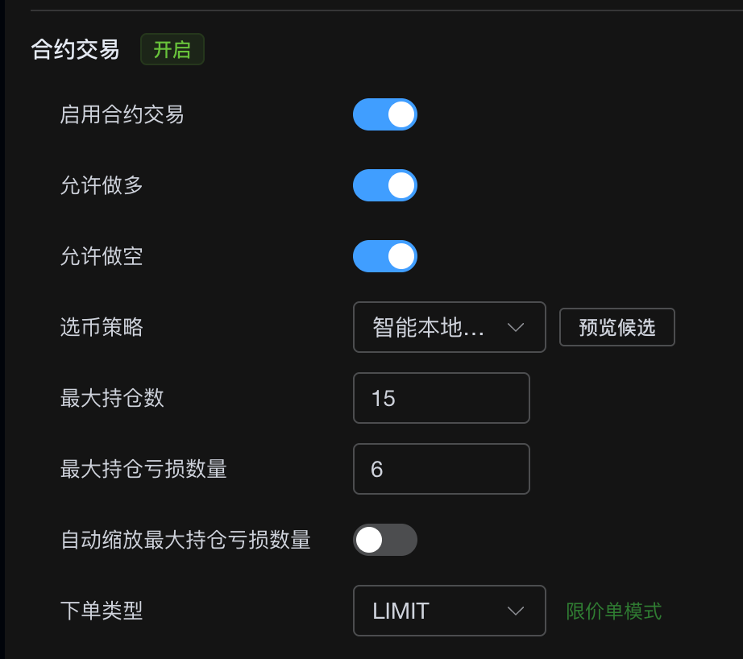
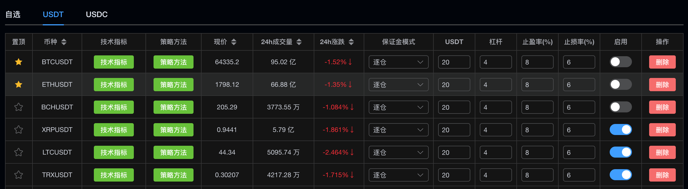

# 合约交易与订单

[返回中文 README](../../../README.md) · [English](../../../README.EN.md)

## 合约交易

`合约交易 → 合约交易` 页面支持每个币种独立配置技术指标、策略方法、策略模板、保证金模式、USDT、杠杆、止盈率、止损率和启用状态。所有合约币种固定使用自定义策略，不再需要选择策略类型。

### 开启方法

1. 在 `配置中心 → 合约交易` Card 内容区打开 `启用合约交易`。
2. 根据需要打开 `允许做多`、`允许做空`，设置选币策略、持仓限制和下单类型。

3. 进入 `合约交易 → 合约交易`，确认目标币种的自定义策略参数、交易参数和 `启用` 状态。

#### 注意事项
1. 目标币种的平仓策略会在配置的 **止盈率(%)** 或 **止损率(%)** 超过之后才会进行。
2. 每个合约币种直接使用自身的自定义策略配置。
3. 目标币种的 USDT 值为合约保证金。

### 配置项说明

#### 快速波动(非必须)

`配置中心 → 快速波动` 可配置启用状态、阈值、恢复阈值、冷却时间和监控窗口。

#### 强平(非必须)

`配置中心 → 强平` 可配置强平订单采集、BTC 强平信号聚合窗口、名义金额阈值和冷却时间。

#### 仓位收益正负转换通知(非必须)

该开关位于 `配置中心 → 合约交易` 的 `下单类型` 下方。当某个仓位的收益在正负之间转换时发送通知。仓位或启用币种较多时会增加 API 请求量，请谨慎开启。

#### 允许做多 和 允许做空(启用交易时必须至少选一个)

这是方向总开关。关闭后，即使策略满足开仓条件，也不会按对应方向自动开仓。

#### 选币策略(必须)

负责决定自动交易候选池，不改变币种执行的自定义交易策略。

#### 最大持仓数量(必须)

自动化持仓达到限制后不再自动开仓，即使策略满足条件。

#### 最大持仓亏损数量(必须)

亏损仓位达到限制后不再自动开仓。`自动缩放最大持仓亏损数量` 可根据连续盈亏自动调整限制。

#### 市场趋势(非必须)

`配置中心 → 市场趋势` 可手动选择市场趋势，也可打开 `市场趋势自动更新`；标题会显示 `自动 / 手动` 状态 Tag，AI 更新进度和最近分析结果也在该 Card 中展示。

#### 自动下单类型

`LIMIT` 为限价挂单，`MARKET` 为市价单。页面会根据选择显示对应模式。

### 量化交易逻辑

1. 当开启了合约交易后，系统会自动根据自定义的策略，检查币种是否要进行开仓和平仓
2. 如果采用 limit 挂单方式开仓，会创建一个挂单(可能无法成交，一段时间后无法成交系统会自动取消)
3. 成功开仓后，可以在 合约订单 和 合约仓位 中查看对应数据
