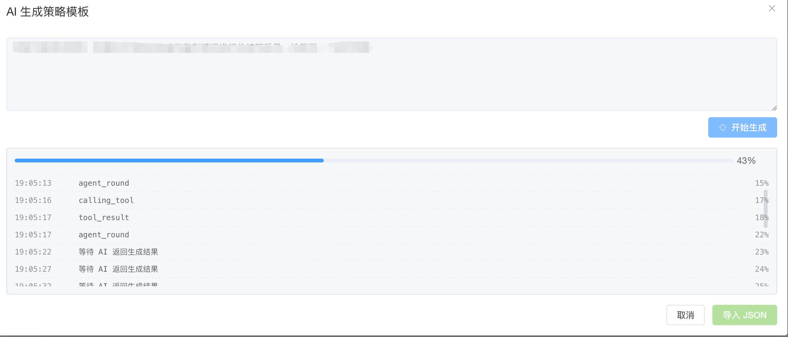

# 策略模板与回测

[返回中文 README](../../../README.md) · [English](../../../README.EN.md)

## 自定义交易策略

### ai 生成策略

### 说明
UI 可在 `合约交易 → 策略模板` 中维护技术指标和策略方法，再到 `合约交易 → 合约交易` 为币种应用模板或直接维护策略配置。

<a href="../../../STRATEGY.CN.md">自定义详情</a>

---

## 历史回测

`合约交易 → 历史回测` 用于使用历史行情重放策略，与实时 `测试策略` 模拟盘相互独立。回测不会向 Binance 提交真实订单，适合比较策略版本、手续费/滑点/杠杆参数以及不同回放精度下的执行结果。

### 回测模式

- **标准 1m（Standard 1m）**：以 1 分钟 K 线为执行主时间轴，使用历史 K 线、Funding、MarketCondition 和当前策略模板进行确定性回放，速度最快，适合作为基准结果。
- **自适应精度（Adaptive Resolution）**：主时间轴仍然是 1m。只有当 1m 无法确定分钟内真实触发顺序，或 ROI Gate 在分钟内可能成立时，才按需下钻到 `1s`；仍有歧义时再读取逐笔 `trades`。不会把整个历史区间全量转换为秒级或逐笔数据。
- 1m 的 `High/Low` 只用于判断“是否需要下钻”，不会直接当成止盈/止损已经成交。真正的平仓规则会在 1s/trade 时间点重新计算并执行，因此 Adaptive 与 Standard 的交易数量、平仓时间和收益出现差异是正常现象。

### 历史数据与高精度缓存

基础回放数据来自本地历史 K 线、策略需要的技术周期、Funding 和 MarketCondition。页面的“获取历史数据”只预取这些基础数据，高精度数据保持 lazy fetch，只在 Adaptive 真正需要时读取。

高精度数据优先读取数据库中的 sparse cache：

- `market_klines_1s`：只保存实际发生 drill-down 的 1s K 线。
- `market_trades`：只保存实际需要的逐笔成交范围。
- Binance USD-M Futures 的官方 1s archive 在部分日期不可用时，会回退到 Binance Public Data 的 daily trades ZIP，并由已校验的 trades 聚合出目标分钟的 1s K 线。
- 同一份 sparse 数据可以跨 Run 复用。首次 Adaptive Run 可能需要下载和解析较大的 daily trades ZIP；后续相同范围命中数据库 cache 时通常会明显更快。
- 每个 ZIP 会校验 Binance 提供的 SHA256 `.CHECKSUM`。逐笔成交按 `trade_time + trade_id` 排序，避免同毫秒成交顺序不确定。

### 结果、审计与可复现性

回测结果会保存策略版本、起止时间、初始资金、仓位比例、杠杆、手续费、滑点、止盈/止损等输入，并展示净收益、回报率、最大回撤、胜率、Profit Factor、Sharpe、Sortino、手续费、Funding、交易次数、持仓时长和多空分项结果。

Adaptive Run 还会记录：

- 1s drill-down 分钟数、trade drill-down 秒数。
- 1s/trade cache hit、archive cache hit、ZIP 下载次数和下载字节数。
- 每笔交易的 `entry_resolution` / `exit_resolution`（例如 `1m`、`1s`、`trades`）。
- Intrabar Resolution 审计事件和实际消费的高精度 evidence。
- `DataHash` 会合并实际使用的高精度数据证据；Engine/Resolution Model 也会随 Run 保存，便于区分不同实现版本。

页面会实时显示构建数据集、普通回放、读取高精度数据、下载 ZIP、解析 ZIP、保存结果等阶段，并显示本次 Run 已消耗的时间。Trades 和 Audit Events 使用分页加载，长区间回测不会一次性把全部明细塞到浏览器。

### 使用建议

1. 在 `合约交易 → 历史回测` 选择策略模板、Symbol、时间范围和回放精度，按需要设置初始资金、仓位比例、杠杆、手续费、滑点、止盈和止损。
2. 首次使用较长区间时可先执行“获取历史数据”；若 MarketCondition 历史缺失，可在页面执行对应的回填操作。
3. 需要对比 Standard 与 Adaptive 时，应固定相同的 `start_time`、`end_time`、策略版本和运行参数，避免把时间区间差异误认为精度差异。
4. Adaptive 的第一次运行可能受 Binance Public Data ZIP 下载速度影响；第二次相同范围若 `second_cache_hits` / `trade_cache_hits` 接近 drill-down 数量且 `archive_downloads=0`，说明数据库高精度缓存已经生效。

> 回测是历史模拟，不是交易所撮合引擎的完整复刻。目前不模拟 order-book queue、maker 排队和完整部分成交深度，因此结果不能作为未来收益保证。

---

## 合约自定义策略的实时模拟盘测试（与历史回测独立）

### 开启方法

在独立的 `配置中心 → 测试策略` Card 中打开测试策略。基础 WebSocket 会由系统自动启动。模拟交易与真实自动交易一样使用各币种的自定义策略和交易限制，但不会操作真实合约账户。结果可通过该 Card 的 `查看测试结果` 按钮，或左侧 `合约交易 → 测试结果` 查看。

`测试自动转换次数限制` 非 0 时，连续盈利达到次数后可切换到真实交易；真实交易连续亏损达到次数后切回测试策略。

---

## 策略模板

在 `合约交易 → 策略模板` 新增或维护模板。模板由技术指标和策略方法组成，可供合约币种和监听策略复用。详细语法请参考 [自定义策略说明](../../../STRATEGY.CN.md)。

---

## 自定义交易策略
> 合约币种固定使用自定义策略，不再提供全局交易策略或策略类型选择。实现参考 `feature/strategy/line/line_custom.go`，规则语法参考 [自定义策略说明](../../../STRATEGY.CN.md)。
