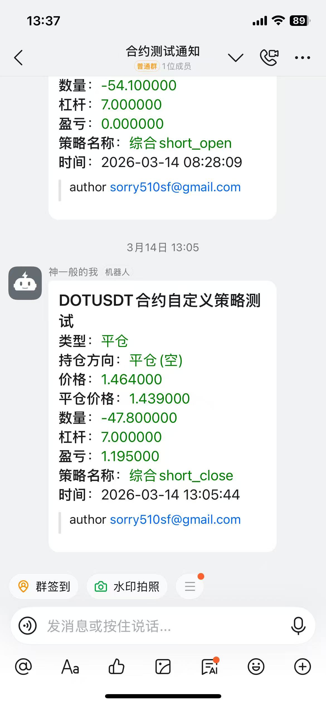
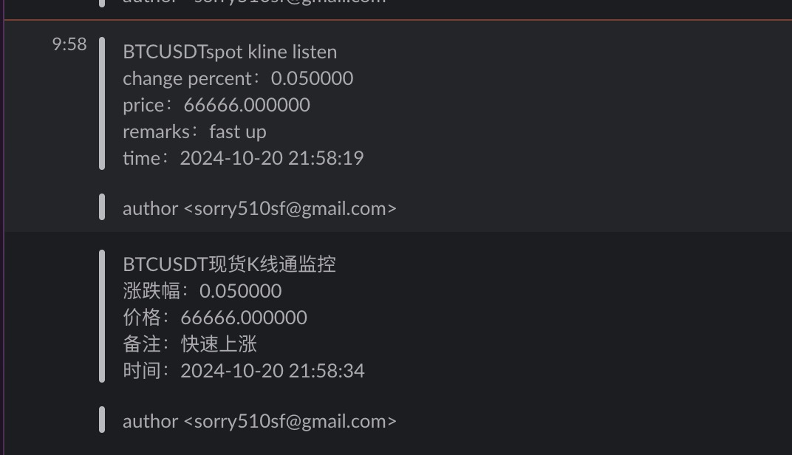
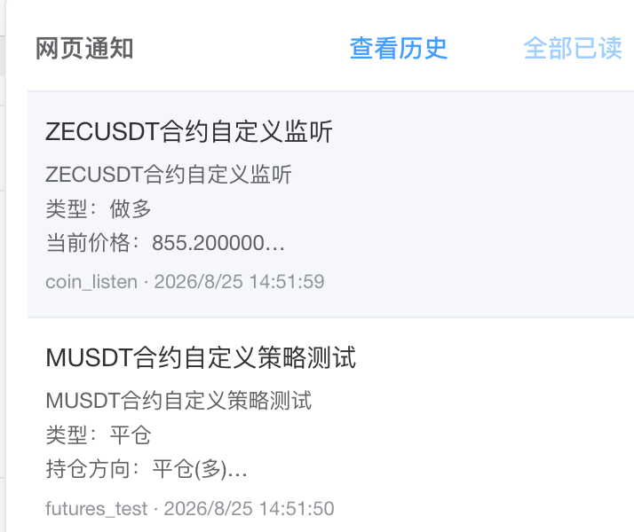

# 行情监控与通知

[返回中文 README](../../../README.md) · [English](../../../README.EN.md)

## 实时推送
> dingding, slack, 网页 websocket 通知

- 钉钉

- slack

- 网页 websocket 通知

---

## 新币抢购

- 币币抢买
- 币币挖矿抢卖
- 合约抢买做多
- 合约抢买做空

先在 `配置中心 → 抢新配置` 打开对应总开关，再到左侧 `抢新配置` 页面新增币种规则。

---

## 币种通知

### 现货通知

- 达到预设价格报警通知
- 自动买入或卖出

### 合约通知

- 达到预设价格报警通知
- 可配置自动交易、保证金模式、USDT、杠杆、止盈价和止损价

先在 `配置中心 → 币种提醒` 打开总开关，再到 `币种提醒 → 现货提醒` 或 `合约提醒` 维护规则。

---

## 行情监听

### 现货监听

- K 线变化监听
- 可配置阈值、通知间隔和启用状态

### 合约监听

- K 线与技术指标监听
- 自定义策略

先在 `配置中心 → 市场监听` 打开总开关，再到 `市场监听 → 现货监听` 或 `合约监听` 新增规则。

---

## 资金费率

- 资金费率查询和历史记录（主列表数据库分页、默认每页 50 条；历史弹窗默认每页 50 条；切换分页不会加载整表）
- 资金费率变化监听

先在 `配置中心 → 资金费率监听` 打开总开关，然后从 `合约交易 → 合约交易` 页「批量编辑」后方的「资金费率」按钮进入原监听页面查询和配置；相邻「市场爆仓」按钮进入原市场强平订单页面。这两个功能不再占用单独菜单。

---

## 新币抢购配置说明

#### 币币抢买功能配置例子

| 币种  |  买卖类型 | 类型  | usdt  | 数量精度  | 开启  |
| ------------ | ------------ | ------------ | ------------ | ------------ | ------------ |
| ABCUSDT(切记带着USDT后缀)   | 买币  | 币币  | 10  |0.1(手动设定会减少一次api请求，不知道时设置为0会在上线时查询接口自动获取)   | 开启   |

#### 币币挖矿抢卖功能配置例子
> ps: 如果挖矿的总价值小于5usdt，不能进行交易

| 币种  |  买卖类型 | 类型  | 数量精度  | 数量 | 开启  |
| ------------ | ------------ | ------------ | ------------ | ------------ | ------------ |
| ABCUSDT(切记带着USDT后缀)   | 卖币  | 币币  | 0.1(手动设定会减少一次api请求，不知道时设置为0会在上线时查询接口自动获取)   | 80(挖矿所得数量) |开启   |

#### 合约抢买做多配置例子

| 币种  |  买卖类型 | 类型  |模式| usdt|  倍率| 数量精度  |  开启  |
| ------------ | ------------ | ------------ | ------------ | ------------ | ------------ |------------ | ------------ |
| ABCUSDT(切记带着USDT后缀)   | 买币  | 合约  | 逐仓或全仓| 10|3 |0.1(手动设定会减少一次api请求，不知道时设置为0会在上线时查询接口自动获取)  |开启   |

#### 合约抢买做空配置例子
| 币种  |  买卖类型 | 类型  |模式| usdt|  倍率| 数量精度  |  开启  |
| ------------ | ------------ | ------------ | ------------ | ------------ | ------------ |------------ | ------------ |
| ABCUSDT(切记带着USDT后缀)   | 卖币  | 合约  | 逐仓或全仓| 10|3 |0.1(手动设定会减少一次api请求，不知道时设置为0会在上线时查询接口自动获取)  |开启   |
