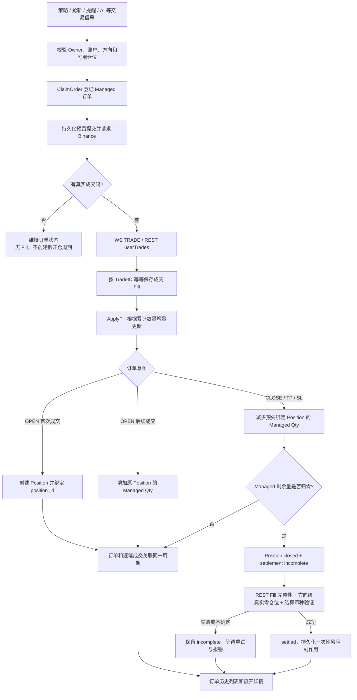

# 合约订单产生、记录、结算及前端展示完整流程

> 对应开发方案：01-0 ～ 01-6（Managed Position + Managed Order + Exchange Fill）。
>
> 代码基准：本地项目当前实现，数据库 Schema v23。本文描述**现有代码设计与实际处理规则**，不代表生产 Binance 实盘验收或部署已完成。
>
> 关联资料：[开发方案](trade/开发方案-01-合约订单审计与部分成交.md) · [01-6 本地验收记录](trade/01-6_本地验收记录.md)

## 一、核心设计

新的合约订单审计采用 **持仓周期 → 订单 → 真实成交** 三层关系：

- **Position（持仓周期）**：一次真实开仓开始，至该仓位完全平仓结束。一个周期只有一个 `position_id`。
- **Managed Order（受管理订单）**：一次交易动作，例如开仓、主动平仓、止盈或止损。一个周期允许有多张子订单。
- **Fill（交易所逐笔成交）**：一次由 Binance 产生的真实撮合成交。每张订单可能对应零笔、一笔或多笔 Fill。

**核心约束：订单提交成功 ≠ 已成交；持仓数量变化 ≠ 可直接确认最终盈亏；仓位归零 ≠ 立即完成结算。**



## 二、三张核心业务表

| 数据表 | 一条记录含义 | 主要关联字段 | 主要职责 |
| --- | --- | --- | --- |
| `futures_managed_positions` | 一次持仓周期 | `id`（即 `position_id`）、`account_id`、`owner`、`symbol`、`position_side` | 当前受管理数量、开仓参考价、状态、创建/结束时间、最终结算状态 |
| `futures_managed_orders` | 一次 OPEN/CLOSE/TP/SL 委托 | `position_id`、`client_order_id`、`exchange_order_id`、`actual_order_id` | 意图、委托量、累计成交量、订单状态和所属周期 |
| `futures_trade_fills` | 一笔 Binance 实际成交 | `position_id`、`client_order_id`、`order_id`、`trade_id`、`account_id` | 真实成交数量、价格、手续费、已实现盈亏、成交时间、REST 验证标志 |

### 2.1 真实成交的唯一性

`futures_trade_fills` 的复合主键：

```text
(market, account_id, symbol, order_id, trade_id)
```

相同成交经 WS、REST 或重放多次到达时，应由此标识幂等保存，不可重复累计。

`qty`、`price`、`commission`、`realized_pnl` 在数据库中使用 `DECIMAL(36,18)`，历史查询以精确小数字符串和有理数运算进行汇总，避免仅靠浮点数计算账务金额。

### 2.2 其他相关表的边界

- `futures_orders`：仍用于交易所订单的 WS/REST 状态镜像、活动订单查询等；**不是新订单历史的结算账本**。
- 旧 `order` 表：已退出新版订单历史业务路径；**旧记录不迁移**、不再使用旧的开平猜测配对方式。
- 无成交且未绑定持仓的 OPEN 委托：可以存在于 `futures_managed_orders` 中，但**不会凭空产生一条 Position 主表记录**。

## 三、订单产生：从信号到 Binance

### 3.1 校验并登记订单意图

交易模块通过 `futuresownership.Executor.Execute()` 进入统一的订单执行流程：

1. 识别交易账户（`main` 或相应绑定账户）与归属 Owner，例如 `auto_strategy`、`new_coin_rush`、`notice_auto_order`、`funding_rate`、`agent_trade`。
2. 校验币种、`LONG/SHORT`、`BUY/SELL`、正的有效下单数量以及 OPEN/CLOSE/TP/SL 的方向规则。
3. 为本次交易确定唯一的 `client_order_id`，调用 `ClaimOrder()` 插入 `futures_managed_orders`，初始状态为 `pending`。
4. OPEN 在第一次实际成交之前，订单可以没有 `position_id`；CLOSE/TP/SL 必须先确认有受管理仓位，**在登记时绑定已有 `position_id`**。
5. 通过持久化提交预留机制防止多进程/重启后重复发单，然后调用 Binance 下单接口。

如果请求发送结果不确定，后续按照 `client_order_id` 查询交易所订单；**不因为 HTTP 超时便使用新 ID 盲目重发**。

### 3.2 订单状态

| 状态 | 含义 |
| --- | --- |
| `pending` | 已登记意图，尚未确认提交 |
| `submitted` | 已提交或预留提交，不能假设有成交 |
| `partially_filled` | 已成交一部分 |
| `filled` | 订单累计成交量满足完成条件 |
| `canceled` | 订单剩余委托已撤销，之前真实成交仍保留 |
| `failed` | 订单确定失败/拒绝 |
| `reconcile_required` | 订单状态、真实成交或发送结果仍需核对 |

状态与 **成交量** 是两个维度：例如一张 `canceled` 订单仍可以累计成交 1 BTC，并保留真实 Fill。

## 四、开仓：首次真实成交才产生 Position

假设 BTCUSDT LONG 请求开仓 **4 BTC**：

1. 系统先创建一条 OPEN Managed 订单：`requested_qty=4`、`filled_qty=0`、`position_id=NULL`。
2. Binance 第一笔真实成交 **2 BTC @ 100**：登记 Fill，`ApplyFill()` 计算成交增量 2，创建新的持仓周期 `position_id=1001`，Managed 数量为 2。
3. 第二笔真实成交 **2 BTC @ 120**：仍在同一订单、同一周期下记录第二笔 Fill，累计成交变为 4，Managed 数量变为 4。
4. 完整的开仓加权成交价为：

```text
open_qty = 2 + 2 = 4
open_notional = 2 × 100 + 2 × 120 = 440
open_vwap = 440 / 4 = 110
```

`ApplyFill()` 使用交易所订单的**累计成交量减去已登记累计量**作为仓位增量，因此重放同一累计数据不会重复加仓。最终历史显示的 VWAP 则从真实 Fill 的 `qty × price` 重新计算，不从委托价、订单 ACK 或当前行情猜测。

**同币种、同方向再次开仓时，只要前一个周期已经关闭，新成交必须创建新的 `position_id`；新旧周期不能因为币种相同而合并。**

## 五、真实成交保存：WS 临时记录与 REST 最终核实

WS `ORDER_TRADE_UPDATE` 中的真实 TRADE 可先进入 `futures_trade_fills`，并更新交易所当前订单镜像。WS 成交记录可能先于 Managed 订单的持仓绑定出现，系统随后依据精确订单身份补充 `position_id`。

字段 `rest_verified` 用于区分：

| 值 | 含义 |
| --- | --- |
| `0` | 已知交易所成交事件，但费用、已实现盈亏等尚未由 REST 完整核实 |
| `1` | 已匹配真实 REST `userTrades` 数据并完成核实 |

核实的数据包括成交 `trade_id`、订单号、数量、价格、`commission`、`commission_asset`、`realized_pnl`、`trade_time` 等。

对同一笔交易，不能同时把 WS 和 REST 记录当作两笔独立成交；REST 可修正原 WS 临时账务事实。若 REST 暂时不可用、成交记录缺失或身份不符，应继续重试或标为未完成，不得伪造费用、盈亏或成交。

对于 TP/SL 等 Binance Algo 条件单，`exchange_order_id` 可能是 **Algo ID**；真正与成交 Fill 对应的是 `actual_order_id`。两者必须分开记录与匹配。

## 六、平仓、止盈、止损和部分撤单

对仓位周期 `position_id=1001`（4 BTC）：

1. CLOSE 订单 A：请求平仓 4 BTC，仅成交 **1 BTC @ 130**，之后取消剩余量。
2. 订单 A 记为 `canceled`，但它的实际成交量为 1，持仓剩余为 **3 BTC**。
3. CLOSE 订单 B：请求平仓剩余 3 BTC，实际成交 **3 BTC @ 140**。
4. OPEN 订单、CLOSE A、CLOSE B **均通过 `position_id=1001` 关联**，整个周期只占历史主表一行。

```text
close_qty = 1 + 3 = 4
close_notional = 1 × 130 + 3 × 140 = 550
close_vwap = 550 / 4 = 137.5
remaining_qty = 4 - 1 - 3 = 0
```

TP/SL 同样被视为属于持仓的平仓意图；保护单的撤销、重挂与触发价继承由各 Owner 的安全恢复逻辑控制，不能从订单历史页面直接重放真实下单。

**人工/外部减仓特别说明**：对账发现真实账户仓位减少时，可以有条件缩小受管理数量并处理过大的保护单，但不能据此虚构一个具有策略 ClientOrderID 和 REST TradeID 的 CLOSE Fill。若这导致开平交易账本不完整，历史净盈亏必须保持不可核实。

## 七、平仓归零 ≠ 最终结算

当受管理的剩余数量变成 0 时：

- Position 可进入 `closed`；
- 如果是新架构周期，结算状态先为 `incomplete`；
- 不会立即把估算利润作为正式结算结果。

最终转为 `settled` 之前，必须确认：

1. Binance 真实持仓查询提供该币种、该 `LONG/SHORT` 方向的**可靠零仓位证据**；批量快照遗漏某个方向，不能当作零。
2. OPEN 与 CLOSE/TP/SL 对应的所有交易所 Fill 已完整关联，Managed 累计成交量与逐笔成交量相符。
3. 逐笔手续费和已实现盈亏已经 REST 核实，资产单位明确且可相减。
4. 订单、周期、账户、Owner、币种和方向身份相互一致。
5. 结算状态持久化 CAS 成功，防止并发进程或重启后重复结算。

证据不满足时，保持 `incomplete` 并继续核查/报警；不能通过 ACK、当前价格或“理论上已经平仓”强行标记 `settled`。

对于 **main 账户 `auto_strategy`**，最终结算交易内会执行一次性的持久化盈亏风控更新。其他 Owner 不应被误算为自动策略的连续亏损记录。

## 八、净交易盈亏和收益率的口径

只有最终 `settled` 且历史查询再次验证完整性的周期，才显示正式的净交易盈亏和收益率。

```text
gross_realized_pnl = Σ 每笔 Fill 的 realized_pnl
total_commission   = Σ 每笔 Fill 的 commission（须为可直接相减的资产）
net_trading_pnl    = gross_realized_pnl - total_commission
nominal_return_pct = net_trading_pnl / Σ(OPEN Fill.qty × Fill.price) × 100%
```

以上例四笔 Fill 的测试数据：

| 成交 | 数量与成交价格 | 手续费（USDT） | 已实现毛盈亏（USDT） |
| --- | --- | ---: | ---: |
| OPEN #1 | 2 @ 100 | 0.10 | 0 |
| OPEN #2 | 2 @ 120 | 0.12 | 0 |
| CLOSE A | 1 @ 130 | 0.08 | 20 |
| CLOSE B | 3 @ 140 | 0.15 | 90 |
| **合计** | **开 4、平 4** | **0.45** | **110** |

因此：

- 开仓 VWAP = **110**；平仓 VWAP = **137.5**。
- 净交易盈亏 = **110 − 0.45 = +109.55 USDT**。
- 名义收益率 = `109.55 / 440 × 100%` ≈ **24.8977%**。

**重要边界**：该净交易盈亏只表示“逐笔成交已实现盈亏 − 成交手续费”，**不包含资金费或其他独立账户收支**。收益率分母为开仓名义成交额，**不是 4 倍杠杆保证金收益率，也不等于账户权益回报率**。

历史 Managed 周期的杠杆快照当前不完整，因此前端 `leverage` 返回 `null` 并显示 `-`，不使用当前设置伪造历史杠杆。没有可靠历史/实时价格数据时，也不伪造未实现盈亏。

## 九、前端“合约交易 → 合约订单”如何展示

新版接口：

| HTTP 接口 | 功能 |
| --- | --- |
| `GET /orders` | 按 `position_id` 分页返回持仓周期汇总 |
| `GET /orders/:position_id/details?account_id=main` | 展开该周期关联 Managed 子订单和逐笔 Fill |
| `DELETE /orders`、`DELETE /orders/:id` | 返回 **410 Gone**，不能删除真实历史成交 |

所有 GET 依赖后台 JWT 登录；当前为**单操作员**模型，可只读 main/Lead。详情需要同时匹配 `account_id + position_id`，不允许跨账户混用。

### 9.1 一级：持仓周期主表（一行 = 一个 position_id）

支持账户（main/Lead）、Owner、币种模糊搜索、LONG/SHORT、持仓状态、结算状态、开仓时间筛选和分页。

主表包括：周期 ID、币种、方向、归属、持仓/结算完整性、真实开/平仓数量、剩余量、开/平 VWAP、手续费、已核实净交易盈亏、名义收益率、周期时长和更新时间。

**完整性标记**：

- `pending`：仓位进行中或尚未满足最终完整核实条件；
- `incomplete`：已关闭但交易账本、REST 数据、身份或结算证据存在待核查问题；
- `verified`：已 `settled`，且列表汇总重新核对所有必需的真实成交与费用。

净盈亏未核实则返回 `null`，前端显示 `-`，**不是 0，也不能展示估算收益**。

页面 `page_verified_net` 仅汇总**当前页**已核实周期的净交易盈亏，并按币种分组；不是全部筛选结果或账户总盈亏。

### 9.2 二级：展开 Managed 子订单

单击某个 Position 行后，前端按需调用详情 API。每张子订单显示：

- OPEN / CLOSE / TP / SL；
- 订单类型、状态；
- 请求数量、来自 Fill 的真实成交量、加权均价；
- 已核实的订单手续费和毛盈亏（无法证明时显示 `-`）；
- `client_order_id`、`exchange_order_id`（含可能的 Algo ID）、`actual_order_id`；
- 订单数据完整性。

一张已取消的平仓单若成交过 1 BTC，二级表会保留**已取消、实际成交 1**，不会因取消而消失或错误显示成交 4。

### 9.3 三级：展开每张订单的真实 Fill

再次展开 Managed 子订单，查看：

`trade_id`、`order_id`、`qty`、`price`、`commission`、`commission_asset`、`realized_pnl`、`pnl_asset`、`trade_time`、`rest_verified`。

WS 暂存成交会明确显示“待 REST 核实”，不会伪装成正式结算。

### 9.4 同币再次交易如何展示

```text
BTCUSDT LONG    position_id=1001    OPEN 4 → CLOSE 1 → CLOSE 3    closed/settled
BTCUSDT LONG    position_id=1002    OPEN 2 → 尚未平仓           active/open
```

主表是**两行**，不会因为币种和方向相同就合成一行；每行展开也只展示属于该 `position_id` 的订单和 Fill。

## 十、异常恢复和不得违反的边界

| 情况 | 应有行为 |
| --- | --- |
| Binance 下单请求超时、结果未知 | 按原 `client_order_id` 查询/核对，不能盲目重复提交 |
| WS 重复、迟到或早于 REST 到达 | 以组合成交身份去重，REST 核实账务字段 |
| 订单部分成交后取消 | 保留已成交 Fill，剩余委托不计入已成交仓位 |
| 未知币种方向级零仓位或缺少精确快照 | 拒绝推断为 0，不提前结算或触发风险副作用 |
| 已结算周期缺 Fill、币种不符、费用不完整 | 历史查询标记 `incomplete`，隐藏不可靠净盈亏 |
| 手动平仓、仓位外部变化 | 不能伪造策略订单与 TradeID；必要时保留核对状态 |
| 手动删除订单历史 | 历史 DELETE 返回 410，不删除真实成交 |
| 旧 `order` 表中的历史记录 | 不迁移、不与新版 Position/Fill 强行配对 |
| 前后端版本不一致 | 必须成套部署，不可只发布新页面后继续使用旧 `/orders` API |

## 十一、对应的代码入口

| 功能 | 主要位置 |
| --- | --- |
| Managed 订单执行、提交与 REST 核对 | `service/futuresownership/execution.go` |
| 订单声明、首次实际成交建仓、累计成交增量 | `service/futuresownership/service.go` |
| 仓位/订单结构及 ID | `models/futures_managed.go` |
| 真实 Fill 的存储、去重与 REST 核实 | `service/tradefills/ledger.go`、`service/tradefills/schema.go` |
| WS `ORDER_TRADE_UPDATE` 入账 | `feature/api/binance/user_data_mirror.go` |
| 仓位/订单恢复、真实仓位核对 | `service/futuresownership/reconcile.go` |
| 归零后的正式结算与一次性自动策略风控 | `service/futuresownership/settlement.go` |
| 新历史只读汇总及三级明细 | `service/orderhistory/history.go` |
| GET / DELETE API | `controllers/orders.go`、`routers/router.go` |
| 新历史页面 | 前端 `src/views/order/index.vue` |
| 前端请求和类型定义 | 前端 `src/api/order.ts` |
| 真实业务逻辑的本地集成测试 | `service/futuresownership/stage016_integration_test.go` |

## 十二、当前实施状态（截至 2026-11-08）

- **代码与离线验证**：01-0～01-6 本地功能、单元回归和模拟交易所的跨阶段测试已经完成；数据库 Schema **v23**。
- **前端产物**：已执行 `pnpm typecheck`、`pnpm build`，并把前端 `dist` 同步至本地后端 `static`（106 个文件，内容校验一致）。
- **后端二进制**：本次静态资源同步**没有替换或启动新的后端二进制**；新页面需要与包含 01-5/01-6 API 的新后端配套使用。
- **生产与真实 Binance**：真实 WS/REST 部分成交、方向级零仓位、不同 Owner 保护单恢复、生产 MySQL 8 查询性能、正式发布及 main/Lead T0 尚未全部验收/授权；本地模拟测试不等同真实交易通过。
- **代码提交（更新于 2026-11-09）**：01-4～01-6 代码和新静态资源已存在于本地 `feat/trade-upgrade` 提交 `8841d8a`，不再是完全未提交工作区；本次 ALL 复审整改尚未 commit/push。**不能据此断言生产代码已发布或推送方式/时间**。

最终数据原则：**一个 `position_id` 是一个真实持仓周期；一个周期可以有多张子订单；每张订单可以有多笔真实 Fill。只记录可证实的成交、只展示可证实的最终净交易盈亏。**

## 十三、全量复审后的 T0 查询门禁（2026-11-09）

新历史不再仅根据数据库 `settlement_status=settled` 认证收益；Main 和 Lead 必须分别配置经过真实发布授权的 UTC 毫秒 T0：`BINANCE_ORDER_HISTORY_T0_MAIN_MS` 和 `BINANCE_ORDER_HISTORY_T0_LEAD_MS`。**当前尚未批准设置真实 T0。** 变量缺失时，旧周期仍可只读展开，但完整性标为 `incomplete: history_not_activated`，主表净收益、收益率、按页净收益和子订单收益汇总均不予认证；周期创建时间早于其账户 T0 时标记 `incomplete: pre_activation_position_cycle`，保留原始 Fill 而不推算历史利润。T0 是历史查询门禁，**不改变开平仓、保护单、逐笔成交记录、持久化结算或现有风险控制**。详见 [ALL 复审整改记录](trade/CODE_REVIEW_01-ALL_整改记录.md)。
